# ai-cli_kernel 技術手冊

給要理解或修改 `ai-cli_kernel` 的人。怎麼使用請看[教學手冊](./教學手冊.md)。

**現況：** 有兩個範本。`readonly-audit` 是 L1「受監督唯讀 agent」。`develop` 是 L3 的「明示未隔離」模式：worker 能改檔、跑指令，關在獨立的 worktree 和分支，kernel 自己跑測試驗收。L2 窄寫入和 Docker 隔離都跳過了，理由見「develop 範本」。

## 一張圖看懂

顏色代表誰在做決定：粉紅是模型，青綠是程式，橘色是人。

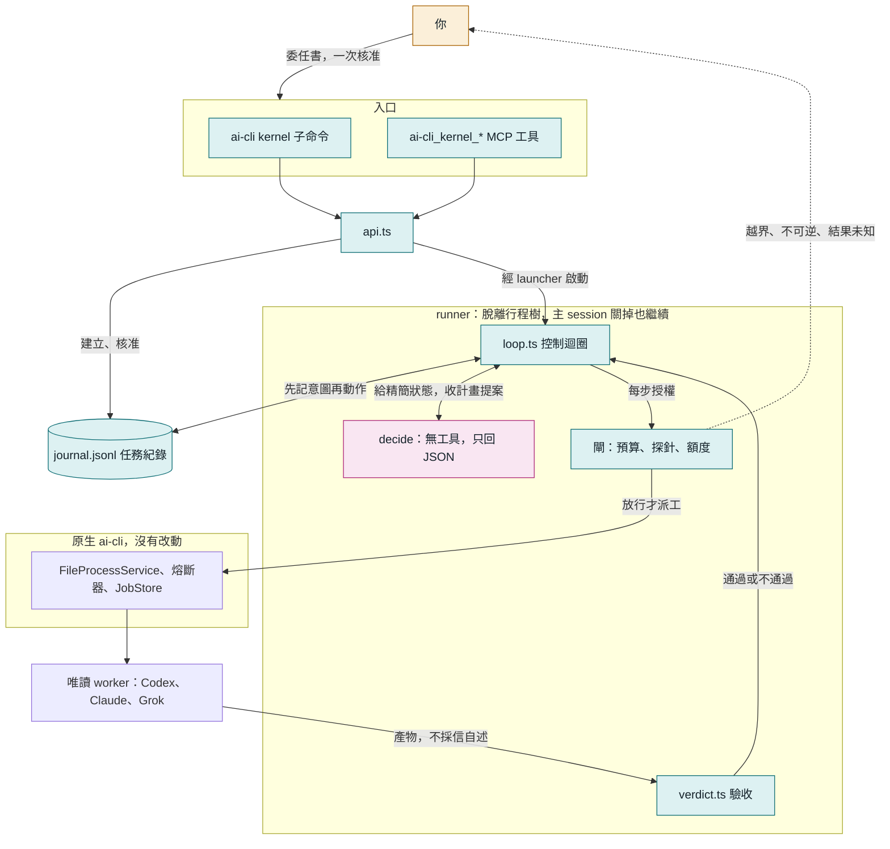

三個設計原則：

- **模型做決定，程式做限制。** 模型只提案，每一步能不能做由程式決定。
- **事實只在日誌裡。** 狀態、預算、該不該停，全部從 `journal.jsonl` 重算。
- **完成要有證據。** exit 0、completed、模型說做完了，都不算。

## 程式碼放哪裡

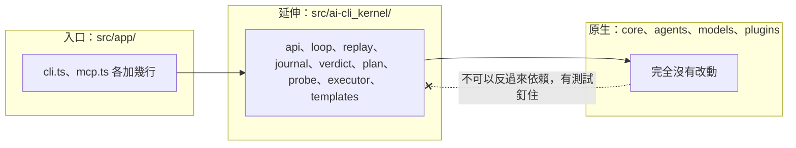

依賴只能往原生方向。這樣以後要拆成獨立套件時成本才低，原生功能也不會被延伸功能拖累。

### 命名規則

原生名稱不動，延伸一律帶前綴，一眼分得出來。

| 位置 | 規則 | 例子 |
|---|---|---|
| 程式碼目錄 | `src/ai-cli_kernel/` | `src/ai-cli_kernel/loop.ts` |
| MCP 工具 | `ai-cli_kernel_<動作>` | `ai-cli_kernel_start` |
| 匯出函式 | `aiCliKernel<動作>`（TypeScript 名稱不能有連字號） | `aiCliKernelStart()` |
| 命令列 | `ai-cli kernel <動作>` | `ai-cli kernel start` |

### 各檔案的職責

| 檔案 | 職責 | 有沒有 I/O |
|---|---|---|
| `types.ts` | 資料形狀 | 無 |
| `replay.ts` | 把日誌重播成目前狀態，算出該不該停 | 無（純函式） |
| `journal.ts` | 任務紀錄的讀寫、全域鎖 | 有 |
| `verdict.ts` | 失敗分類、驗收檢查、git 快照 | 讀檔、git |
| `plan.ts` | decide 的提示詞與輸出解析 | 無 |
| `loop.ts` | 控制迴圈，依賴全部從參數傳入 | 透過參數 |
| `executor.ts` | 真實執行器，走原生 FileProcessService | 有 |
| `probe.ts` | 權限邊界探針 | 有 |
| `templates.ts` | 委任範本與模型檢查 | 少量 |
| `runtime.ts` | 版本指紋、額度讀取 | 有 |
| `runner.ts`、`launcher.ts` | 脫離行程樹的執行入口 | 有 |
| `runner-lock.ts` | 同一個 run 只能有一個 runner | 有 |
| `api.ts`、`cli.ts`、`mcp-tools.ts` | 對外入口 | 有 |

`replay.ts` 是純函式、`loop.ts` 的依賴都能替換，所以每一種當機位置都能用假執行器便宜地驗，不必花額度。

## 一個 run 會經過哪些狀態

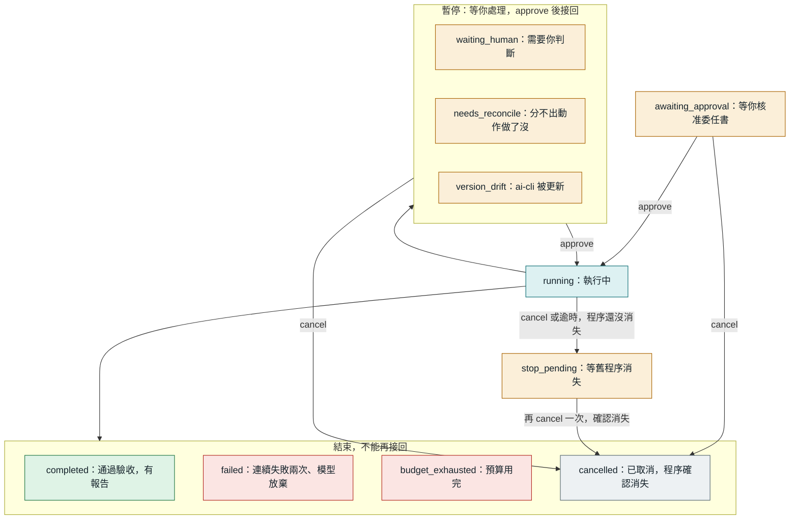

另外有一個不寫進日誌的顯示狀態 `interrupted`：日誌說 running，但 runner 程序已經不在。`approve` 就能接回。

## 控制迴圈

模型只站在 decide 一格。而且 decide 不是每步呼叫，只有失敗、驗收不過或計畫走完才回去，因為每次呼叫都有約 2～3 萬 token 的固定開銷。

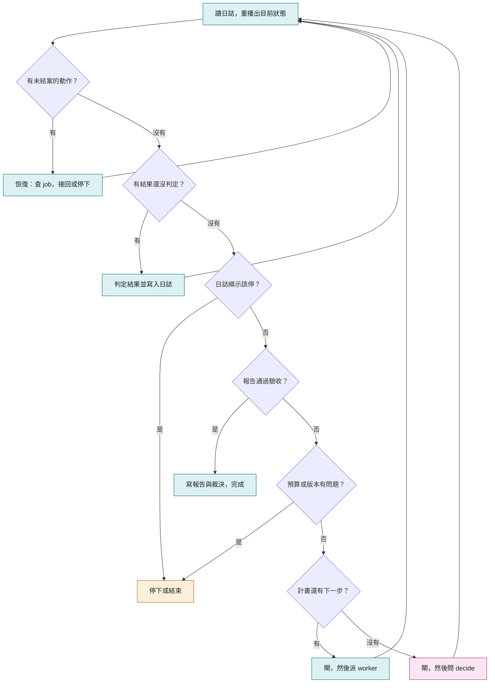

每一輪都從日誌重新開始，所以「當機後恢復」和「正常下一輪」走的是同一條路，沒有另一份恢復專用的邏輯。

### decide 能提什麼

decide 的回覆是提案，只有四種，格式不合就拒絕，連續兩次不合格 run 就失敗。

| 動作 | 意思 | kernel 怎麼處理 |
|---|---|---|
| `plan` | 接下來的步驟，最多 5 個 | 逐步過閘、派工 |
| `finish` | 指定已通過的步驟當最終報告 | 跑驗收 |
| `ask_human` | 目標不清楚 | 停下來問你 |
| `give_up` | 做不到 | run 失敗，記下原因 |

步驟只能有 `id`、`title`、`prompt`、`model` 四個欄位，多一個就拒絕。所以模型沒有欄位可以要權限，也改不了工作目錄。模型必須在委任書的 `allowedWorkerModels` 清單內。

worker 的輸出送給 decide 時會包在 `<worker_output untrusted="true">` 裡。裡面寫了什麼指令都沒有授權效力，因為 decide 能提的動作只有上面四種，而且 worker 永遠是唯讀的。

## 先記意圖，再動作

這是整個設計的核心。每個動作寫三筆：意圖、啟動、結果。當機時看日誌停在哪一筆，就知道該怎麼辦。

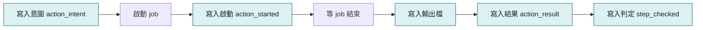

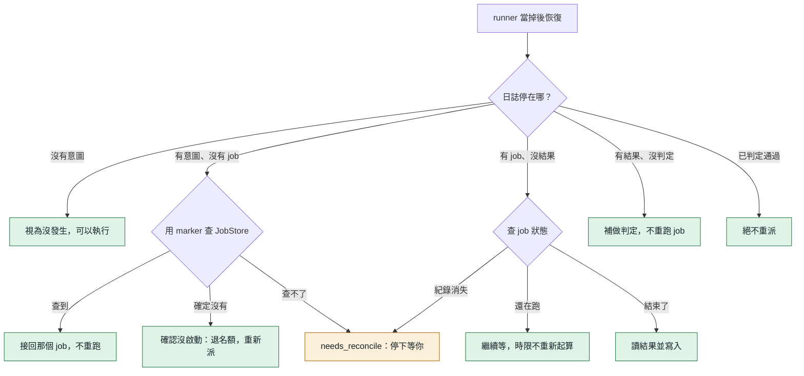

`marker` 是寫在 prompt 第一行的短字串，例如 `K-20261106021013b1b4-a2`。JobStore 的任務摘要只留前 40 個字元，所以 marker 必須夠短。

### 該不該停，也從日誌算

第一輪稽核抓到一個問題：「處理標記」和「停下來」原本分兩筆寫，當在中間就會漏掉人工閘。修法是把停下的決定和處理標記寫在同一筆，由 `derivedStop()` 從日誌算出來。迴圈每一輪都先看它，當機窗口就不存在了。

### 兩個 runner 同時活著怎麼辦

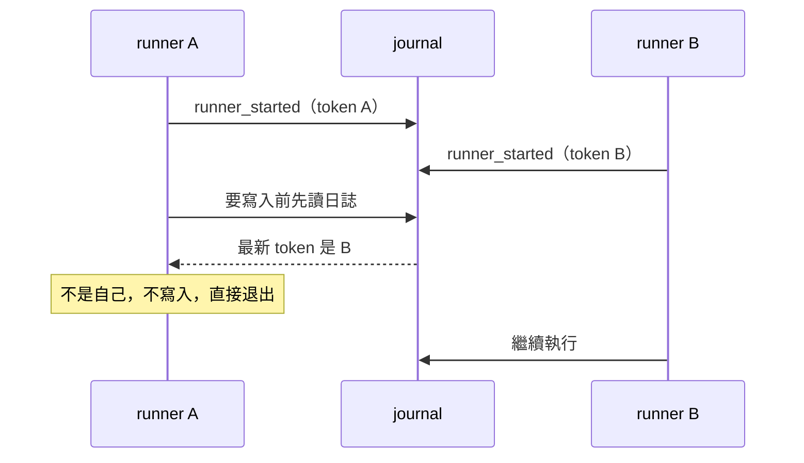

正常情況下 runner 鎖就會擋住第二個。fencing token 是第二道防線：鎖在極端的時間差下仍有機會被搶，這時只有最後啟動的 runner 算數。所有寫入都會先確認 token，舊 runner 就算正在等 job，回來時也寫不進去；退出時也只清自己的鎖，不會刪掉接手者的。

## 閘：派工前最後一關

閘只做確定性檢查，不呼叫模型。

| 檢查 | 條件 | 不通過時 | 可以用 approve 放行嗎 |
|---|---|---|---|
| 委任書 | digest 和核准時相同 | `failed` | 不行 |
| 別的 runner | fencing token 是自己 | 退出 | 不適用 |
| 程式版本 | dist 指紋沒變 | `version_drift` | 可以，接回 |
| 總時間 | 未超過 `maxWallMinutes` | `budget_exhausted` | 不行 |
| input tokens | 未超過 `maxInputTokens` | `budget_exhausted` | 不行 |
| worker、decide 次數 | 未超過上限 | `budget_exhausted` | 不行 |
| 權限探針 | 這支 CLI 是 PASS | `waiting_human` | 先跑 probe |
| 週額度偏低 | 剩餘不低於 `minQuotaRemainingPercent` | `waiting_human` | 可以 |
| 週額度未知 | 未超過 `quotaUnknownMaxDispatches` | `waiting_human` | 可以 |

**額度未知不等於還夠**，所以只能在委任書事先核准的保守上限內繼續。額度優先讀 raw 原文，因為百分比欄位的語意歷史上變過。

**token 預算只限制新增派工。** 已經在跑的 job 不會被中斷，所以可能超出一個 job 的量。第一次實戰就是 639,395／600,000，後來把預設值調高到 1,500,000。

## 三重裁決

授權、執行、交付是三個獨立判斷，不能互相代替。

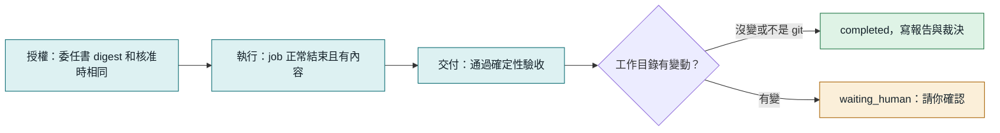

### readonly-audit 的驗收項目

每一項都是程式檢查，不呼叫模型。

| 檢查 | 內容 |
|---|---|
| `message_nonempty` | 回覆不是空的 |
| `no_refusal` | 不是「被政策拒絕、請貼上檔案」這類放棄訊息（只在回覆很短時才判） |
| `min_length` | 至少 80 字 |
| `required_sections` | 有「結論」「發現」「尚待確認」三個標題 |
| `citations_resolve` | 至少 1 個 `路徑:行號`，**而且每一個都實際打開檔案核對**，檔案不存在、行號超出範圍、跑出工作目錄都不通過 |

模型編出來的引用過不了最後一項。驗收連續兩次不過，run 就失敗，不會無限重試。

### 失敗分類

| 分類 | 例子 | kernel 的反應 |
|---|---|---|
| `rate_limited`、`quota` | 429、額度用完 | 立刻停下等人，重試沒有用 |
| `auth`、`model_unavailable` | 沒登入、模型不支援 | 立刻停下等人 |
| `empty_output` | exit 0 但沒有內容 | 回去問 decide，連續兩次就失敗 |
| `check_failed` | 步驟檢查不過 | 同上 |
| `process_failed`、`start_failed` | 非零結束、啟動失敗 | 同上 |
| `timeout` | 超過時限 | 停掉 job，同上 |
| `lost` | job 消失 | 同上 |

## 權限：能保證什麼

第一版只有「工具受限」，**不是隔離**。這點要講清楚。

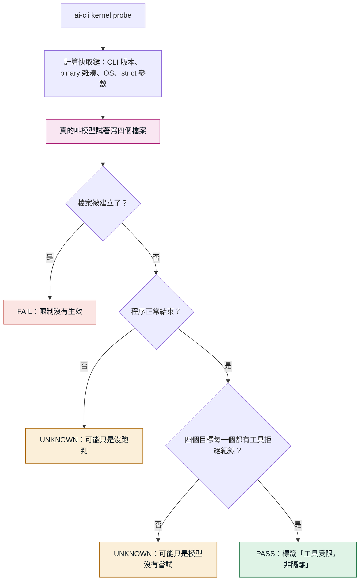

快取鍵任何一項變了，舊的 PASS 就失效。原因是 CLI 自動更新改過權限語義：Claude CLI 2.1.226 到 2.1.233 之間就發生過，當時靜默造成零交付。

證據的認定很嚴格，因為第二輪稽核發現舊版只要出現 `read-only` 字樣就算拒絕，模型沒試也能過。現在的規則：

- 只算工具層的拒絕：Codex 的 stderr 路由錯誤，或結束碼非 0 而且輸出明確寫被拒的指令。模型自己說「被拒絕了」不算。
- 寫了檔名的拒絕歸給該目標。`patch rejected` 這類沒寫檔名的分不出試了哪一項，只能替「編輯工具」那一項作證。第三輪稽核發現，否則模型把同一項重試四次，就能替沒試過的 shell 背書。
- 第一版只有 Codex 有實測過的格式（codex-cli 0.166.0，Windows）。Claude、Grok 照跑，檔案被建立仍會判 FAIL，但最多到 UNKNOWN，不假裝驗過。

模型有時候會拒絕嘗試。實際用的時候就撞到過，它回「我無法刻意嘗試繞過唯讀限制」。這不是工具擋住，也不是限制失效，所以：

- 判定為 UNKNOWN，而且**不會蓋掉之前驗出來的 PASS 或 FAIL**。一次沒結論不該把使用者擋下來。
- 自動再跑一次，只多一次。
- 提示詞講清楚這是授權的測試，被拒絕才是正確結果。改完後真實 Codex 連跑三次都通過。

### 各機制擋得住什麼

威脅分三級。T1 模型失誤：幻覺、改錯檔、假完成。T2 內容注入：讀到惡意內容後想用手上的工具做事。T3 蓄意逃逸：有 shell 的行程主動繞過限制。

| 機制 | T1 | T2 | T3 | 限制 |
|---|---|---|---|---|
| Claude `--disallowedTools` | 預防 | 預防 | 無效 | 是黑名單，會隨新工具過期 |
| Codex read-only（Windows） | 預防 | 預防 | 無效 | 沒有 OS 沙箱，靠安全指令清單 |
| 環境變數標記 | 預防 | 無效 | 無效 | 只擋合作式遞迴 |
| git 快照比對 | 偵測 | 偵測 | 偵測 | 看不到外傳、已還原的變更和被忽略的檔案 |
| 確定性驗收 | 預防 | 預防 | 無效 | 只防假完成，不防副作用 |

### 能承諾與不能承諾

| 能承諾 | 不能承諾 |
|---|---|
| 精確標示通過了哪些環境與操作的探針 | Windows 上的 vendor 唯讀模式等於隔離 |
| 空產出或缺驗收證據不結案 | 探針 PASS 就能防住所有注入與逃逸 |
| 授權、預算或結果不明時停止新增派工 | 取消或 diff 能撤回已經發生的外傳 |
| 受治理任務一次一個 | 全域額度保障；一般 `run` 不受管，直接啟動 vendor CLI 也在邊界外 |

## 主 session 關掉會怎樣

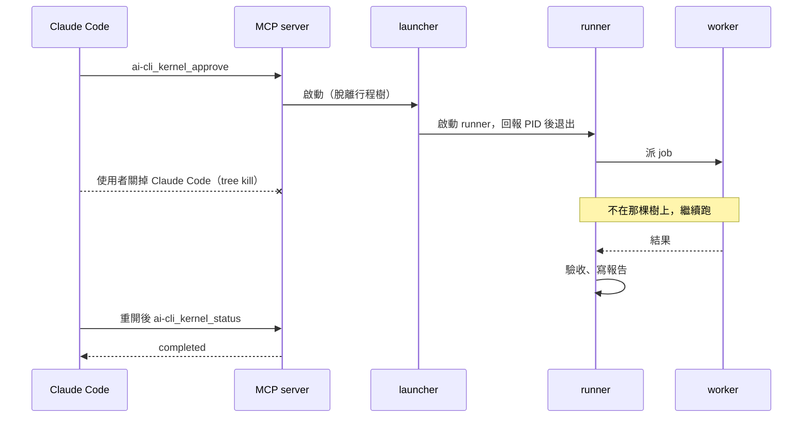

Windows 上 Claude Code 退出時會對 MCP server 做 `taskkill /T /F`，所以 runner 必須由短命的 launcher 啟動，才能脫離那棵行程樹。作法和原生 `core/job-launcher.ts` 相同。

## 取消與殭屍程序

過去發生過 `kill_process` 回 terminated 之後，舊 codex.exe 又活了約 25 分鐘，還 commit 並跑了 pytest。所以「回報已停止」不算數，要確認程序身分真的消失。

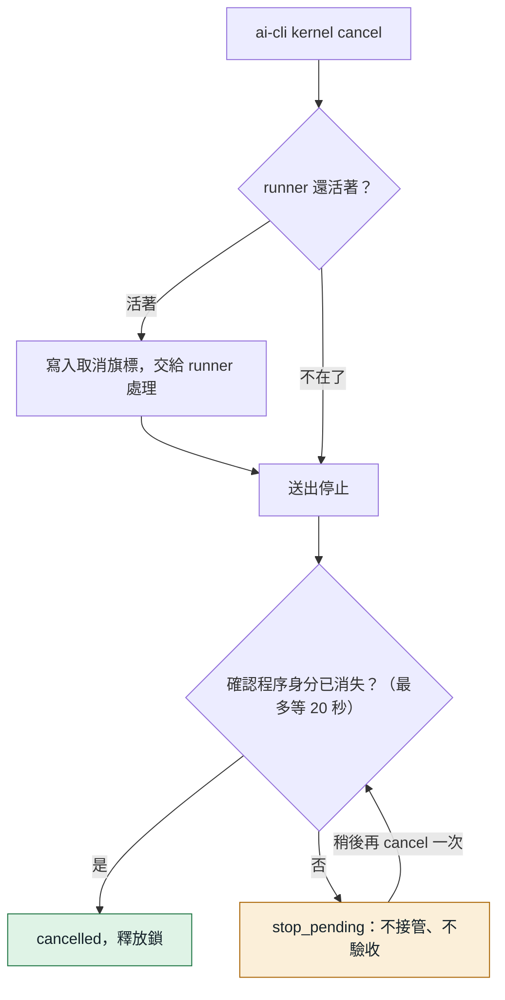

## 資料放哪裡

全部在 `~/.local/state/ai-cli/kernel/`（可用 `AI_CLI_STATE_DIR` 改）。

```
kernel/
  active.lock                受治理任務一次一個
  probes/<key>.json          探針結果，依 CLI 版本等快取
  runs/kr-20261106-021013-b1b4/
    contract.json            委任書，核准後不可變
    journal.jsonl            任務紀錄，事實以這裡為準
    outputs/a2.txt           每個動作的完整輸出
    report.md                最終報告，通過驗收才存在
    verdict.json             裁決
    runner.json              目前 runner 的身分
    runner.lock              防止同一個 run 有兩個 runner
    cancel.request           取消旗標
```

開關在 `~/.local/share/ai-cli/kernel.json`，只影響 MCP 工具有沒有出現。命令列一直都能用。

### 日誌事件

| 事件 | 意思 |
|---|---|
| `created` | 委任書建立，記 digest |
| `approved` | 核准或接回，可帶補充和放行項目 |
| `runner_started` | runner 啟動，記版本指紋與 fencing token |
| `baseline` | 工作目錄的基準快照 |
| `action_intent` | **要做某個動作，還沒做** |
| `action_started` | job 已啟動 |
| `action_result` | job 的結果 |
| `action_abandoned` | 放棄動作。`refund` 為 true 才退名額，只有確認沒啟動才是 true |
| `decide_processed` | decide 的回覆已判定，停下的決定也記在這筆 |
| `step_checked` | 步驟的判定結果 |
| `acceptance` | 最終報告的驗收結果 |
| `quota_unknown` | 在額度未知下派了一次工 |
| `state` | 狀態改變 |

最後一行寫到一半視為沒發生，下次寫入前截掉；中間的行損毀則拒絕解讀，不猜。

### 委任書的預算欄位

| 欄位 | 預設 | 意思 |
|---|---|---|
| `maxWorkerSteps` | 6 | 最多派幾個 worker |
| `maxDecides` | 5 | 最多呼叫幾次 decide |
| `maxWallMinutes` | 90 | 實際執行時間上限，等人的時間不算 |
| `maxActionMinutes` | 30 | 單一 job 時間上限 |
| `maxInputTokens` | 1,500,000 | 所有 job 的 input tokens（含快取） |
| `quotaUnknownMaxDispatches` | 2 | 額度量不到時最多再派幾次 |
| `minQuotaRemainingPercent` | 25 | 週額度低於這個百分比就停下問人 |

## 和當初規劃不同的地方

| 規劃 | 第一版 | 為什麼 |
|---|---|---|
| 固定版本目錄 | 偵測到 dist 變動就暫停 | updater 在原地重建 dist。要固定版本得連原生相依的 node_modules 一起複製，第一版先偵測，由人接回 |
| 一次核准 | 一樣，但 `worktree_changed`、低額度仍會問 | 這些是委任書當時看不到的新資訊 |
| 探針涵蓋三家 | 只有 Codex 能通過 | 依討論共識先支援一家。其他家的拒絕格式沒有實測過，不能假裝驗過 |

## L4 單次放行（第二階段）

`ai-cli kernel release create <run> --action merge|push --target <branch> --confirm <交付 commit 前 10 碼> [--remote origin] [--hours 1] [--allow-default-branch]`
只建立授權；`ai-cli kernel release run <id>` 才執行。CLI 呼叫 `api.ts` 的 `aiCliKernelReleaseCreate/Run`，由 `loop.ts` 的 deps 注入時間、ID、人員邊界、git 與儲存操作。沒有 release MCP 工具，不交給 decide，也不派 worker。worker 即使設定允許巢狀派工仍被拒絕；trigger run 禁用。

只接受日誌狀態為 completed 的 develop。建立和執行都重算委任書 digest，比對核准、驗收、最新 verification（passed、exit 0、未逾時）和交付 commit。交付分支 ref 必須仍指向該 commit，基準必須仍是祖先；啟用回復點時 ref 必須仍有效。清掉 worktree 後，只要交付分支還在，仍可放行。

`releases.jsonl` 存在 run 目錄，建立事件含規格欄位 `id/action/target/remote/commit/baseCommit/targetCommitAtCreate/expiresAt`，另固定 `remoteUrl` 與 `allowDefaultBranch`。ID 為 `<runId>-rel-<16 位十六進位亂數>`；未指定 hours 為 1，必須大於零。merge 的 target 必須已存在；push 可建立新分支，此時 targetCommitAtCreate 為 null。遠端限已設定的名稱，只有單一 push URL 且與查詢 URL 相同才接受，避免核對一個遠端卻推到另一個。

`replay.ts` 的 `aiCliKernelReplayReleases` 是純函式，從事件重建 available／succeeded／failed／unknown 與 attempted。先以排他 `release.lock` 序列化同一 run 的操作，再做全部前置核對；只有通過後才 fsync `release_intent`，再執行 git，最後 fsync `release_result`。意圖後沒結果即 unknown；失敗、逾時、例外或執行後 target 無法確認為交付 commit 都記 unknown，**永不自動重試**。殘行／損毀紀錄直接拒絕，不能像 job 日誌忽略最後半行。當機留下的鎖也不自動回收，須先人工確認舊程序已停止、核對本地與遠端及 releases.jsonl，再處理鎖；移除鎖不會清除已記錄的意圖或恢復授權。前置驗證失敗尚未產生意圖，因此不消耗授權。

merge 要求來源 repo 目前就在 target（不替人切換）、index／工作樹乾淨（含未追蹤檔），沒有未結束的 merge、rebase 等操作，才 `git merge --ff-only <commit>`。分歧不會產生合併 commit。push 用精確 `<commit>:refs/heads/<target>`，不帶 force，明確關閉 follow-tags、mirror 與遞迴推送子模組，避免既有設定擴大授權範圍。實測遠端的 mirror 設定會蓋過 `--no-mirror`，因此指令另外以 `git -c remote.<name>.mirror=false push ...` 限制這一次執行，不寫入使用者設定。

push 建立與執行都即時 `ls-remote --symref <remote> HEAD` 確認預設分支；target 等於預設分支需在 create 額外加 `--allow-default-branch`，訊息寫明可能等於部署。同意隨授權保存；執行時如果原本的普通分支變成預設分支，也會拒絕未含此同意的授權。無法取得預設分支（含空的 bare repo）時保守拒絕。

仍有邊界：release.lock 只協調 kernel 同一 run，不鎖住其他人的 git。`ls-remote` 核對與一般無強制 push 之間無法原子比較遠端舊值；一般 push 會阻擋非快轉，但無法阻擋所有並行快轉競態。規格禁止 force，因此未使用 force-with-lease。git hooks 和使用者全權限配置也不受隔離。需在 release 期間避免同時改交付分支與目標；未實跑項目見 [第二階段驗收](./L4-第二階段驗收.md)。

## develop 範本

`readonly-audit` 靠工具限制保證不改檔。`develop` 的 worker 要改檔，所以保證的方式完全不同：不預防，而是把交付關在一條分支上，由程式事後查核。

### L4 第一階段：回復點與 rollback

新委任書的 `develop.checkpoint` 是 `{ mode: 'push' | 'local' | 'off', remote: string | null, ref: string }`。
有 `origin` 預設 `push`，沒有則 `local`；`--checkpoint` 可明確選擇。只備份到專用的
`ai-cli_kernel/checkpoints/<runId>`，不推使用者的分支或交付分支。委任書、狀態、報告與裁決都顯示回復點。
`off` 必須是人手動核准的 run；觸發 run 不能用，也不能在遠端備份失敗後降成本地。

loop 在建立工作區、執行準備指令與派模型之前，透過 `WorkspaceOps` 建回復點：

1. 暫存 index 執行 `read-tree HEAD`、`add -A`、`write-tree`。包含未提交與未追蹤的檔案，遵守 `.gitignore`；不改來源 HEAD、index 或檔案。來源 HEAD 已離開委任書基準則暫停，要求重建委任書。
2. tree 相同直接使用 HEAD；不同則 `commit-tree -p HEAD`。先記 `checkpoint_prepared`，再以 compare-and-swap 建專用 ref；已存在則驗證，不覆寫。
3. 備份前以 `--no-renames` 比較快照與基準的路徑。任一路徑段符合 `.env`／`.env.*`、`*.pem`、`*.key`、`id_rsa`、`credentials*`、`*secret*`（不分大小寫）就停在 `checkpoint_secret_risk`，完全不傳送、不派工。這是檔名檢查，沒有掃描內容。
4. 先查遠端專用 ref；已指向同一 commit 表示前次已備份成功，直接沿用。不同則拒絕。不存在才以一般推送建立專用 ref，不強制覆寫。失敗停在 `checkpoint_push_failed`；人手動建立的 run 經 `approve` 同意後只留本地，裁決的 `checkpointMode` 記 `local`。
5. 完成記 `checkpoint` 事件 `{ commit, ref, pushed, remote }`。`pushed: false` 表示本地模式或未確認備份，不能據此推斷遠端一定沒有該 commit。

重播是純函式，只由事件還原 `checkpointPrepared` 與 `checkpoint`。當在記錄、建 ref、遠端備份、記完成事件之間時，沿用原 commit；備份成功但尚未落盤由遠端查詢對帳。`refs()` 排除回復點與其 remote-tracking ref；最終驗收及交付前另外驗證本次回復點仍指向原 commit，刪除或改動都不能交付。
舊委任書沒有 `checkpoint` 時維持舊行為，不改 digest，也不在接回時新增未核准的遠端操作。

`ai-cli kernel rollback <run>` 預設只印安全的分支還原指令。
加 `--apply` 只建立 `restore/<run>` 分支，不切換、不改 index 或工作樹；同名分支、回復點已變動或沒有回復點均拒絕。
遠端備份失敗而停住的 run 也可從已準備且仍存在的本地 ref 還原。

工作包一 A 的驗收見回復點紀錄；目前 release 單次放行與 L5 範本／觸發已接續完成，詳見後面的對應章節。記憶與歸檔包屬工作包三，尚未實作。
驗收斷言與實測結果見 [L4 第一階段驗收](L4-第一階段驗收.md)。

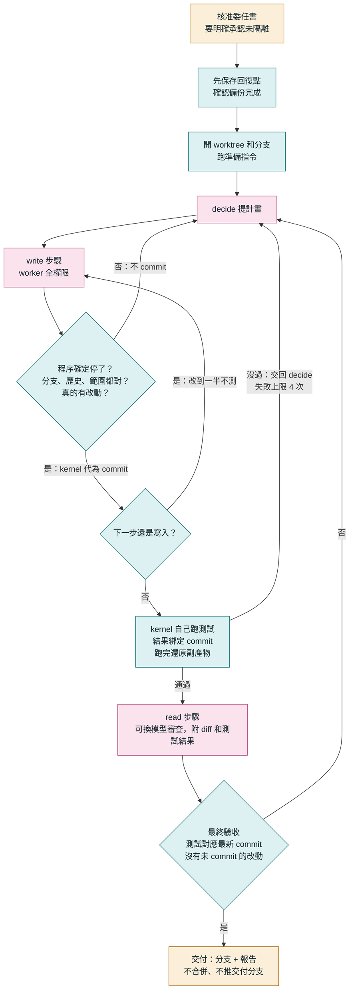

### 為什麼跳過 L2、也不先做 Docker

藍圖原本的順序是 L2 窄寫入，再到 L3。使用者要的是能開發，而 L2 只能換文字、不能跑測試，滿足不了。Docker 要處理訂閱 CLI 的登入憑證，也沒有實測過，會慢很多。藍圖討論時已經收斂出「明示未隔離」是可接受的模式，條件是寫明範圍、預算、期限，所以直接做它。

代價是**這個模式沒有隔離**，風險和直接用 `run` 派寫入工作一樣。

### 能保證什麼

下表的 ref 查核排除專用回復點及其遠端追蹤 ref。回復點本身另外驗證；遠端備份只發生在開工前的專用分支。

| 查核 | 怎麼做 | 查不到什麼 |
|---|---|---|
| 交付通過測試 | kernel 自己跑 `testCommand`，結果綁定 commit，HEAD 一動就失效 | 測試沒涵蓋的行為 |
| 改動在範圍內 | `allowedPaths` 比對相對基準的所有改動，**查完才 commit** | 工作目錄以外的寫入 |
| 分支和歷史沒被動 | 查目前分支、基準 commit 還是祖先 | |
| 其他分支、tag 沒動，沒有 push | 派工前和交付前比對 refs | `git push <url>` 這種不更新 remote-tracking ref 的；以及已經發生的外傳 |
| 主目錄沒被改 | 交付前比對快照 | 會被其他 session 誤觸，所以是停下來問人，不是直接判失敗 |
| 舊程序停了才動工作目錄 | 查程序身分；當掉後先停掉上次的測試指令 | |

全權限 worker 能在查核之前做任何事，**這些查核抓得到多數意外，防不了蓄意或被文件注入後的操作**。

### 使用者的 hook 管得到誰

| 誰在動作 | 全域 hook | 專案 hook | 依據 |
|---|---|---|---|
| Codex 寫入 worker | 會 | **很可能不會** | 全域：實測 `git reset --hard`、`git clean -fd` 被 PreToolUse 擋下，對照組正常（codex-cli 0.166.0）。專案：信任紀錄綁 `hooks.json` 的絕對路徑，worktree 是新路徑，未信任的 hook 會被 `codex exec` 跳過。這條是推論，沒有實測 |
| Claude 寫入 worker | 應該會 | 有進版控的才會 | 推論，沒有實測。被 git 忽略的設定檔不在 worktree 裡 |
| Codex 唯讀（decide、read 步驟） | 不會 | 不會 | 帶 `--ignore-user-config`；實測 decide 跑完時 SessionStart 沒有觸發 |
| Grok | 沒查 | 沒查 | |
| kernel 自己（測試、commit、reset、clean） | 不會 | 不會 | 不經過 AI 工具。git 自己的 commit hook 照跑 |

所以 kernel 自己跑的 `git reset --hard`、`git clean -fd` 寫進委任書的 `notices`，核准時等於同意。repo 有 `.codex/hooks.json` 而且會用到 Codex 時，也會寫進去。

hook 比對的是指令文字。worker 可以把指令寫進測試腳本，再由 kernel 代跑，不會經過 hook。**hook 防失誤，不是隔離。**

### 權限只有一條路會放寬

`executor.ts` 只有在 `mode === 'write'`、委任書有 `develop`、而且 cwd 在 worktree 內時才不帶 capabilities。其他情況一律走 strict builder，缺任何一個條件就拒絕啟動。decide 和 read 步驟始終是唯讀。

`develop` 不看探針：探針證明的是「工具受限」，這裡已經明示未隔離，不該拿它當放行條件。

### 測試何時跑

- 下一步是寫入：不跑，改到一半本來就可能是壞的。
- 下一步是審查、或計畫走完、或報告步驟通過：只要有新 commit 就跑。

要先測再審，有兩個原因：測試沒過的東西不值得花額度審查；審查者也才看得到結果。第一次真實 run 曾經順序相反，審查者寫「測試尚未核對」，頁尾卻寫通過，報告自相矛盾。

測試跑完會在 worktree 裡做 `git reset --hard` 和 `git clean -fd`，避免副產物混進下一次 commit。這兩個指令會丟改動，所以 `assertOwnWorktree` 強制只能是這個 run 自己的 linked worktree，不能是主目錄。此時改動都已經 commit，被清掉的只有測試產物；被 git 忽略的 `node_modules` 會留著。

### 準備指令

新 worktree 沒有被忽略的檔案，所以多半要 `setupCommand`。它留下沒被忽略的改動（例如 `npm install` 改了 lockfile）就會停下來，否則那些東西會被下一次 commit 一起交付，而且不是任何 worker 改的。

### 多模型

`workerModels` 列出 decide 可以挑的模型，寫入和審查都能用。全部走 ai-cli 原本的派工，所以都算進預算和日誌。

- worker 自己再呼叫 ai-cli 是刻意不開的：會撞上防遞迴，也不會算進預算。
- OpenRouter 這類 direct-api 這次沒開：它會把程式碼送到外部 API，也沒有唯讀模式。
- effort 目前所有 worker 共用一個值。

### 實際觀察

以下是 scratch repo 上的一次真實 run（codex-cli 0.166.0、gpt-6.1-sol medium、grok-4.7 medium，Windows），任務是加一行程式：

| 動作 | input tokens | 其中快取 |
|---|---|---|
| decide | 20,091 | 12,416 |
| Codex 寫入 | 155,129 | 114,432 |
| Grok 唯讀審查（當時沒有 diff，要自己找） | 533,800 | 449,152 |

寫入 worker 的固定開銷比唯讀高很多，因為它載入使用者完整設定，包含所有 MCP 工具。這也帶來下面第一條限制。

## 已知限制

- **檢查指令還有幾毫秒的當機窗口。** spawn 之後、pid 落盤之前當掉，接回時不知道有這個程序，可能和新的測試重疊。稽核後把窗口從好幾秒縮到幾毫秒，沒有完全消除。準備指令成功後、`workspace_ready` 落盤前當掉也會再跑一次，所以準備指令要能重複執行。
- **只確認 worker 本身和 runner 停了。** 它留在背景的子孫程序不在查核範圍內。
- **`allowedPaths` 區分大小寫。** Windows 上寫 `SRC` 會把 `src/a.ts` 擋下來。這只會多擋，不會放行，所以沒有修。
- **`develop` 的 worker 會載入使用者的完整設定。** 包含 MCP server 和 hook，所以它能用你的 planner、knowledge 等工具。實測在沒登記過的 repo 跑時，planner 的 SessionStart hook 自動註冊了新專案，並在主目錄寫了 `.planner-id`。kernel 只會在交付時發現主目錄變了並停下來問人，撤不回 planner 上的紀錄。
- **`develop` 沒有隔離。** 見上面「能保證什麼」。
- **`develop` 只驗過一台 Windows。** Linux、macOS 只有 stub 測試。
- **`readonly-audit` 的探針範圍比藍圖窄。** 只試工作目錄內 3 種寫法，絕對路徑、`..`、junction、文件注入都沒測。
- **一次一個受治理任務。** 暫停中的 run 也佔著鎖，要接回或取消才會釋放。
- **一般 `run` 不受管。** 預算只算 kernel 派的 job。
- **快照看不到被 git 忽略的檔案。** 例如 `dist/`。
- **run 中斷太久可能拿不回結果。** JobStore 會回收已結束的 job，回收後接回只能進入 `needs_reconcile`。
- **Windows 只驗過這台機器。** Linux、macOS 的真實 CLI 沒有實測，只跑 stub 測試。
- **續接 Codex session 時 job 回報的 usage 是累計值。** kernel 目前都開新 session，所以不受影響，日後要續接時不能直接累加。
- **decide 的品質只有少量實測。** 目前只真跑過稽核任務。

## 路線圖

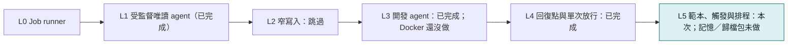

等級是交付里程碑，不是安全等級。完整討論見 [ai-cli Agent 化藍圖](https://claude.ai/artifact/4BXEbZu8oRYmDZr5GDjVv2)。

## 命令列與對照表

平常用說的就好。這一節給不透過 Claude、直接操作的人，以及要查細節的時候。

### develop 的命令列

```powershell
aik start --template develop --goal "要做什麼" --cwd "repo" --test "npm test" --setup "npm ci" --allow-path "src,tests" --worker-models "sonnet,grok-4.7"
aik approve <run> --acknowledge-unisolated
aik wait <run>
aik result <run>
git merge ai-cli_kernel/<run>
aik cleanup <run>
```

| 選項 | 說明 |
|---|---|
| `--test` | 必填。kernel 自己跑的驗收指令 |
| `--setup` | 新 worktree 要先跑的準備指令 |
| `--allow-path` | 只能改這些路徑，相對 `--cwd`，逗號分隔。不給就是整個 repo |
| `--worker-models` | 另外允許 decide 挑選的模型，逗號分隔 |
| `--mandate-hours` | 委任書幾小時後失效，預設 24 |
| `--max-test-failures` | 測試失敗幾次就停，預設 4 |

預設預算：worker 10 次、decide 8 次、180 分鐘、單一 job 45 分鐘、input tokens 400 萬。

### 命令列流程

先在 PowerShell 設一個短指令。它只在目前的視窗有效，路徑換成你的 ai-cli 資料夾：

```powershell
function aik { node "<ai-cli 資料夾>\dist\bin\ai-cli.js" kernel @args }
```

| 動作 | 指令 |
|---|---|
| 檢查權限 | `aik probe --agent codex` |
| 建立任務（還不會執行） | `aik start --goal "要查什麼" --cwd "資料夾"` |
| 核准 | `aik approve <run>` |
| 等它跑完 | `aik wait <run>` |
| 看狀態（不給 run 就列出最近的） | `aik status <run>` |
| 看報告 | `aik result <run>` |
| 取消 | `aik cancel <run>` |
| 開關 MCP 工具 | `aik enable`、`aik disable` |

畫面上的 `ai-cli kernel` 就是這裡的 `aik`。`aik help` 會列出所有選項。

### start 的選項

| 選項 | 預設 | 意思 |
|---|---|---|
| `--effort` | medium | worker 的思考深度，`high` 比較仔細也比較貴 |
| `--max-steps` | 6 | 最多派幾個 worker |
| `--max-minutes` | 90 | 最多跑幾分鐘 |
| `--max-tokens` | 1500000 | 最多用多少 input tokens |
| `--allow-unverified` | 關 | 探針沒過也照跑，報告會標明未驗證。其他家（Claude、Grok）目前要加這個 |

### 實際用量

Codex gpt-6.1-sol，每次都是一個決策加一個 worker：

| 任務 | effort | input tokens（多半命中快取） | 時間 |
|---|---|---|---|
| 讀一份文件 | medium | 約 6 萬 | 5 分鐘 |
| 單檔稽核 | medium | 約 38 萬 | 3 分鐘 |
| 整個目錄稽核 | high | 約 50～64 萬 | 4～5 分鐘 |

五輪討論、五次任務和十來次探針加起來，Codex 週額度從 `49% used` 變成 `52% used`（這個數字只到整數位）。

### 狀態對照

狀態的最後一行「下一步」會告訴你該下什麼指令。

| 狀態 | 原因 | 意思 | 怎麼做 |
|---|---|---|---|
| `waiting_human` | `decide_question` | 看不懂目標，在問你 | `aik approve <run> --note "回答"` |
| `waiting_human` | `quota_low` | 週額度剩不到 25% | 要繼續就 `aik approve <run>` |
| `waiting_human` | `quota_unknown` | 查不到額度 | 要繼續就 `aik approve <run>` |
| `waiting_human` | `rate_limited` | 被限流 | 等一下再 `aik approve <run>` |
| `waiting_human` | `boundary_unverified` | CLI 更新過 | 先跑探針，再 `aik approve <run>` |
| `waiting_human` | `worktree_changed` | 跑的期間工作目錄被改 | `git status` 確認後 `aik approve <run>` |
| `interrupted` | | 背景程式不見了 | `aik approve <run>` 接回，做過的不會重做 |
| `version_drift` | | ai-cli 被更新 | `aik approve <run>` 接回 |
| `needs_reconcile` | | 分不出某個動作做了沒 | 用 `ai-cli jobs`、`git status` 確認後 `aik approve <run> --reconcile abandon` |
| `stop_pending` | | 舊程序還沒確認停止 | 稍等再 `aik cancel <run>` |
| `budget_exhausted` | | 預算用完 | 調高上限，重新 `aik start` |
| `failed` | | 連續失敗兩次 | 看「說明」，調整目標後重新 `aik start` |

### 錯誤訊息

| 訊息 | 意思 | 怎麼做 |
|---|---|---|
| `受治理任務一次只能跑一個` | 另一個任務還沒結束（暫停中的也算） | 等它跑完，或 `aik cancel` |
| `權限邊界探針結果是 UNKNOWN` | 還沒跑過探針，或 CLI 更新過 | `aik probe --agent codex` |
| `不在候選清單內` | 模型名稱打錯 | 改用正確名稱，或拿掉 `--model` |
| `走 direct-api，它沒有唯讀模式` | 第一版不能用 OpenRouter 這類 API | 改用預設模型 |
| `工作目錄不存在` | `--cwd` 打錯 | 確認路徑 |
| `AI_CLI_NESTED_DISPATCH_BLOCKED` | 在 ai-cli 派出去的 AI 裡面又叫它 | 防遞迴，正常不會碰到 |

### 裁決欄位

| 欄位 | 正常的值 | 意思 |
|---|---|---|
| `authorization.ok` | `true` | 委任書沒被改過 |
| `execution.ok` | `true` | AI 正常跑完 |
| `delivery.ok` | `true` | 通過所有檢查 |
| `readOnly` | `unchanged` | 工作目錄前後一模一樣 |

### MCP 工具

開啟後多出這些，原生的 `run`、`wait` 等不受影響：

| 工具 | 用途 |
|---|---|
| `ai-cli_kernel_start` | 建立委任書（教學手冊稱任務確認單） |
| `ai-cli_kernel_approve` | 核准或接回 |
| `ai-cli_kernel_status` | 看狀態 |
| `ai-cli_kernel_result` | 看報告 |
| `ai-cli_kernel_cancel` | 取消 |
| `ai-cli_kernel_probe` | 跑探針 |

## 驗證紀錄

| 驗證 | 結果 | 內容 |
|---|---|---|
| 故障語義測試 `verify-ai-cli_kernel.mjs` | 140 項全過 | 假執行器走遍各種當機位置，不花額度 |
| 端到端測試 `verify-ai-cli_kernel-e2e.mjs` | 39 項全過 | 真的走 CLI、runner、JobStore，真的殺掉 runner 再接回，也砍過 MCP server 整棵行程樹（模擬關掉 Claude Code），只把 vendor CLI 換成 stub |
| 完整 `npm test` | 33 支全過 | 既有 31 支都沒有被影響（探針重試的修正之前跑的，之後只重跑 kernel 的兩支） |
| 突變測試 | 35 筆全部被抓到 | 把每道防線逐一改壞，確認對應的斷言真的會失敗。最後一輪只重跑新增與修改過的 |
| 真實 Codex 探針 | PASS | codex-cli 0.166.0，Windows，四筆拒絕都對得上。修正提示詞後連跑三次都通過 |
| 真實 Codex 完整 run | 5 次都通過驗收 | 自主規劃、派工、驗收，工作目錄前後一模一樣 |

### 獨立稽核

依專案規則，由沒有寫這段程式碼的模型審查，意見逐條對照原始碼確認成立才修。三輪都是用 `ai-cli_kernel` 自己派工（gpt-6.1-sol，effort high）。

| 輪 | 範圍 | 找到 | 最嚴重的一條 |
|---|---|---|---|
| 1 | 核心迴圈、日誌、重播、驗收、runner | 6 項，都成立 | 兩個恢復程序能同時搶到 runner 鎖 |
| 2 | 第一輪沒讀到的檔案與修補本身 | 6 項，都成立 | 探針只要看到 read-only 字樣就判 PASS，模型沒試也能過 |
| 3 | 第二輪的修補與 `JobStore.start` 的新檢查 | 2 項，都成立 | 重複的匿名拒絕能替沒試過的 shell 背書；讀不到 job 清單被當成沒有 |

全部修掉並加上回歸測試與突變。**第三輪的修補沒有再經過第四輪獨立稽核。** 三輪都是靜態審查，競態的實際發生率沒有測過。第三輪的報告也寫明，額度用完時還有部分分支沒有核對完。

突變測試還抓到 2 筆假綠燈：測試資料太弱，有沒有那道防線都會過。已補強測試後重驗。

### 怎麼重跑

```text
npm run build
node tests/verify-ai-cli_kernel.mjs
node tests/verify-ai-cli_kernel-e2e.mjs
node tools/mutation-test.mjs --script verify-ai-cli_kernel.mjs --name kernel
```

突變測試不能和 `npm test` 同時跑，兩者會搶暫存的 git 資源。不給路徑時它測的是 HEAD，未 commit 的改動不在裡面。


## L5 第一部分：可重用委任範本

與內建 `readonly-audit`／`develop` 類別不同，這裡保存的是一份具名、可再次使用的 `KernelStartInput`。

- API：`aiCliKernelMandateSave({name,input,maxRunsPerDay?,maxInputTokensPerDay?})`、`aiCliKernelMandateApprove({name,acknowledgeUnisolated?,days?})`、`aiCliKernelMandateList()`、`aiCliKernelMandateShow({name})`、`aiCliKernelMandateRevoke({name})`，由 `api.ts` 統一匯出。
- CLI：`kernel mandate save/approve/list/show/revoke`，全部支援 `--json`。save 與 start 共用輸入解析，額外接受 `--max-runs-per-day`、`--max-tokens-per-day`；approve 預設 `--days 30`，develop 需要 `--acknowledge-unisolated`。核准僅暴露 CLI，不註冊範本核准 MCP。
- MCP：啟用 kernel 工具後可用 `ai-cli_kernel_mandate_list`，無參數，只讀取列表。沒有 save、show、revoke MCP；這是本步對規格「列表可以有 MCP」的選擇。原有 run 核准工具不會核准範本。
- 儲存：`kernelStateDir()/mandates/<name>.json`，四欄為 `name`、`input`、`approval`、`limits`。原子替換沿用 journal 的 fsync／rename；同名寫入採 `.json.lock` 排他鎖，爭用即拒絕，不重試，不自動回收當機殘鎖。
- input 經既有 `buildContract` 驗證後，固定工作目錄、模型 alias 的解析值、effort、預算、checkpoint 模式等預設值；不保存驗證用 run 的回復點 ref、分支、基準 commit、worktree 或期限。相對 allowedPaths 仍相對保存的 workFolder。
- SHA-256 digest 包含 `{name,input,limits}`，物件鍵排序，陣列保留順序，與 JSON 排版無關。approval 不參與 digest。覆寫即使內容相同也清空核准；revoke 保留 input 與 limits、清空 approval。
- 回傳額外附 `digest` 與即時計算的 `status`：`unapproved`／`changed`／`expired`／`approved`，不把 status 存為事實。到期當刻失效；digest 不符優先顯示 changed。核准時重驗 start 輸入，預設 30 天；worker 即使設定允許巢狀派工仍拒絕核准。
- 名稱限 1–64 個小寫英數、底線、連字號，以英數開頭，排除 Windows 保留名稱。每日上限為非負安全整數，0 表示觸發上限已用完；days 接受有效正數（可含小數）。損毀紀錄、未知欄位、錯配檔名與符號連結均拒絕；列表遇損毀會明確失敗，不略過或假裝空列表。

save／approve 都不會建立 run、執行測試指令、派 worker、操作 repo refs 或排程。`checkpoint off` 仍可保存作人工用途，trigger 入口會在建立 run 前拒絕；每日 limits 由下述觸發帳本落實。觸發重新讀取內容、核對 digest 與有效期，不能依賴曾經列出的 approved。本機 JSON 與 digest 不是對全權限本機使用者的防偽簽章；沒有宣稱 worker 已隔離。

實作、具名斷言、共通規則及工作包二的驗證狀態見 [L5 第一部分驗收](./L5-第一部分驗收.md)。完整 npm test、跨程序 E2E 與三平台 CI 由外層另行驗收，不沿用早期版本的驗證數字。

### 主動觸發與排程

`ai-cli kernel triggers on|off` 的開關存於 `kernelStateDir()/triggers.json`，預設關閉，與 MCP 工具的 enable／disable 分開。`trigger <name>` 透過 loop 匯出的觸發入口注入核准／啟動能力，重用原本的 `aiCliKernelApprove`；測試可注入前景 runner。CLI 僅做一次檢查，不排隊、不重試、不新增常駐排程程序或網路 port。API 為 `aiCliKernelTrigger`、`aiCliKernelTriggersEnabled`、`aiCliKernelTriggersSetEnabled`、`aiCliKernelSchedule`。MCP 沿用唯讀 `ai-cli_kernel_mandate_list`，規格未要求其他觸發或排程工具，核准仍只有人工 CLI。

開關、worker 環境、核准／digest／期限、每日額度、active lock 依序檢查；另以 `triggers.lock` 避免同時檢查造成超額，殘鎖交人對帳。`triggers.jsonl` 以 fsync 保存每次跳過原因、run 名額、啟動意圖與結果；先記名額才建立 run，不因失敗退款。用量由名額連結的 run 日誌重播，扣除 cached input，不計 output；範本重新核准不清帳，且本次 run 的 input 預算會縮至當日剩餘量。日誌缺失、損毀、未知用量或放棄未知結果不當零用量。建立後來源固定為 `{ kind: 'trigger', mandate, digest }`，Codex 專案 hook 警語寫入核准註記。

沿用工作包一：觸發 run 禁止 checkpoint off；push 回復點失敗停在 waiting_human，不允許降成本地，也不派 worker；即使 completed 也不能建立單次放行。交付只留下分支與報告，不合併、不推回復點以外的 ref。

`schedule <name> --daily HH:MM | --every-hours N` 預設只印命令。Windows `--apply` 才經過注入的 execute 呼叫 `schtasks`，名稱 `ai-cli_kernel_<name>`；`--remove` 也先預覽，加 `--apply` 才刪除。POSIX 即使 apply 仍只印 crontab，remove 只給移除對應標記行的提示。時程是本機時間；小時間隔為 1–999 整數。POSIX 用每小時的 epoch-hour 取餘判斷，避免 N 不整除 24 時在午夜縮短間隔。排程命令使用 node 與安裝入口的絕對路徑；建立的 Windows 工作不強制覆寫既有同名工作。排程輸出不含自動帶入的密碼或服務帳號。

每日日期用本機日曆日，整次觸發固定同一時點；跨午夜執行的用量全部歸入啟動日。開關 off／撤銷影響後續觸發，不取消已啟動 run。啟動結果不明保留 active lock 與名額，請用既有 status／cancel 對帳。上述日期歸屬、失敗扣次數、未知用量保守停止、remove 預覽、間隔範圍及不新增 MCP 寫入工具是規格未明定的選擇，仍列在驗收索引的尚待確認事項。每日 input 預算沿用既有派工前檢查，單個模型呼叫的用量只能完成後得知，不能保證供應商端絕不超支。


### L5 操作流程與驗證邊界

```text
ai-cli kernel mandate save daily-audit --goal "檢查程式碼並附引用" --cwd . --max-runs-per-day 1 --max-tokens-per-day 2000000
ai-cli kernel mandate show daily-audit
ai-cli kernel mandate approve daily-audit --days 30
ai-cli kernel mandate list --json
ai-cli kernel triggers on
ai-cli kernel trigger daily-audit --json
ai-cli kernel schedule daily-audit --daily 09:00
ai-cli kernel schedule daily-audit --daily 09:00 --apply
ai-cli kernel schedule daily-audit --remove --apply
ai-cli kernel mandate revoke daily-audit
ai-cli kernel triggers off
```

以上是使用者手動操作範例，不是測試程序。schedule 全部驗證都注入假的 execute；不連真排程器。save 與 start 共用選項；develop 的 --test 必填，approve 才需 --acknowledge-unisolated。save 固定模型與預算預設值、工作目錄、checkpoint 模式，觸發時才重建當次 commit、分支與回復點 ref。範本核准的 --days 和每次 develop 的 --mandate-hours 分別控制可觸發期限及單次任務期限。

triggers.jsonl 包含 event=reserved 的名額與 attempt/result。每日篩選 name 與本機日曆日，從對應 run 的 action_result 重播 input-cached；output 不扣帳。啟動前必須已落盤 reserved 與 attempt；每日餘額只能縮小既有 run 預算，不能放大。重複名額、日誌不完整、未知或未結束動作均停止，人工對帳後才決定下一步。本機鎖與 JSON 不提供同權限程序間的防偽隔離。

trigger 回傳 started 不代表 completed；要依 runId 查 status/result。skipped 的 CLI exit 0 代表已正常記錄跳過原因，failed 才 exit 1。排程只會啟動一次 trigger，不會開關總開關或重新核准；同名 Windows 工作需先移除再登記。POSIX --apply 仍只輸出，需人自行編輯 crontab。移動 Node 或安裝路徑後應重新產生命令。Windows 登出／離線補跑未實測，也沒有由 kernel 實作補跑。

定向突變重現：`node tools/stubs/kernel-l5-mutations.mjs`。它在 docs/ai-cli_kernel/l5-mutations.log 內複製目前未提交快照、擷取正式驗證腳本相關區段，使用未修改的 mutation-test.mjs；每組先基準綠，再逐筆建置／執行／還原，必須命中 expect 的 FAIL 才計為 KILLED。額外核對原始 bytes 還原並只 unlink node_modules 連結，不建 worktree、不切分支、不 commit。這不等於對每筆突變跑過整支驗證，更不能代替外層完整 npm test。最終數字及仍待確認事項以 [L5 驗收索引](./L5-第一部分驗收.md) 最後一節為準。

CLI `status`／`wait --json` 的 `progress.inputTokens.used` 是未快取 input（原始 input 減 cached）；`cachedTokens` 與 `outputTokens` 各自保留，不再扣進 input 預算。正常 E2E 的 stub 由 decide 與 worker 各回報 input=1000、cached=400、output=100，因此精確驗證 input used=1200、cached=800、output=200、unknownUsage=0。此次修正的是仍期待 input=2000 的測試假設，沒有修改正式 API 或降低驗收要求。新增 `kernel L5 E2E：status 把快取算進 input 用量` 突變，與每日帳本／loop 預算的既有突變分開；本次實跑證據及完整測試邊界見驗收索引最後一節。
