# ai-cli_kernel 技術手冊

給要理解或修改 `ai-cli_kernel` 的人。怎麼使用請看[教學手冊](./教學手冊.md)。

**現況：** 第一版，等級 L1「受監督唯讀 agent」。只跑唯讀任務，範本只有 `readonly-audit`。

## 一張圖看懂

顏色代表誰在做決定：粉紅是模型，青綠是程式，橘色是人。

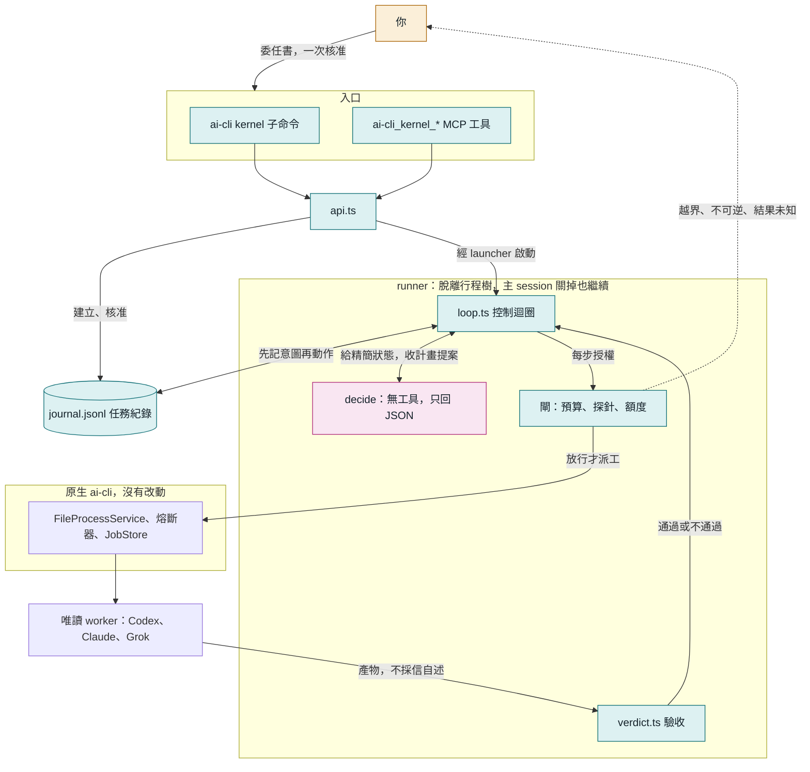

三個設計原則：

- **模型做決定，程式做限制。** 模型只提案，每一步能不能做由程式決定。
- **事實只在日誌裡。** 狀態、預算、該不該停，全部從 `journal.jsonl` 重算。
- **完成要有證據。** exit 0、completed、模型說做完了，都不算。

## 程式碼放哪裡

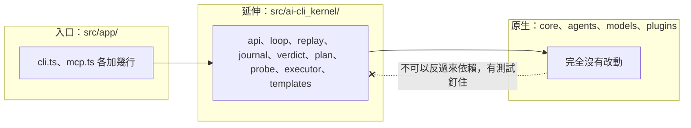

依賴只能往原生方向。這樣以後要拆成獨立套件時成本才低，原生功能也不會被延伸功能拖累。

### 命名規則

原生名稱不動，延伸一律帶前綴，一眼分得出來。

| 位置 | 規則 | 例子 |
|---|---|---|
| 程式碼目錄 | `src/ai-cli_kernel/` | `src/ai-cli_kernel/loop.ts` |
| MCP 工具 | `ai-cli_kernel_<動作>` | `ai-cli_kernel_start` |
| 匯出函式 | `aiCliKernel<動作>`（TypeScript 名稱不能有連字號） | `aiCliKernelStart()` |
| 命令列 | `ai-cli kernel <動作>` | `ai-cli kernel start` |

### 各檔案的職責

| 檔案 | 職責 | 有沒有 I/O |
|---|---|---|
| `types.ts` | 資料形狀 | 無 |
| `replay.ts` | 把日誌重播成目前狀態，算出該不該停 | 無（純函式） |
| `journal.ts` | 任務紀錄的讀寫、全域鎖 | 有 |
| `verdict.ts` | 失敗分類、驗收檢查、git 快照 | 讀檔、git |
| `plan.ts` | decide 的提示詞與輸出解析 | 無 |
| `loop.ts` | 控制迴圈，依賴全部從參數傳入 | 透過參數 |
| `executor.ts` | 真實執行器，走原生 FileProcessService | 有 |
| `probe.ts` | 權限邊界探針 | 有 |
| `templates.ts` | 委任範本與模型檢查 | 少量 |
| `runtime.ts` | 版本指紋、額度讀取 | 有 |
| `runner.ts`、`launcher.ts` | 脫離行程樹的執行入口 | 有 |
| `runner-lock.ts` | 同一個 run 只能有一個 runner | 有 |
| `api.ts`、`cli.ts`、`mcp-tools.ts` | 對外入口 | 有 |

`replay.ts` 是純函式、`loop.ts` 的依賴都能替換，所以每一種當機位置都能用假執行器便宜地驗，不必花額度。

## 一個 run 會經過哪些狀態

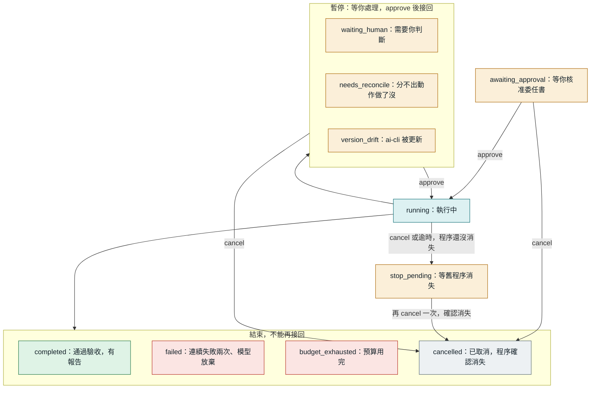

另外有一個不寫進日誌的顯示狀態 `interrupted`：日誌說 running，但 runner 程序已經不在。`approve` 就能接回。

## 控制迴圈

模型只站在 decide 一格。而且 decide 不是每步呼叫，只有失敗、驗收不過或計畫走完才回去，因為每次呼叫都有約 2～3 萬 token 的固定開銷。

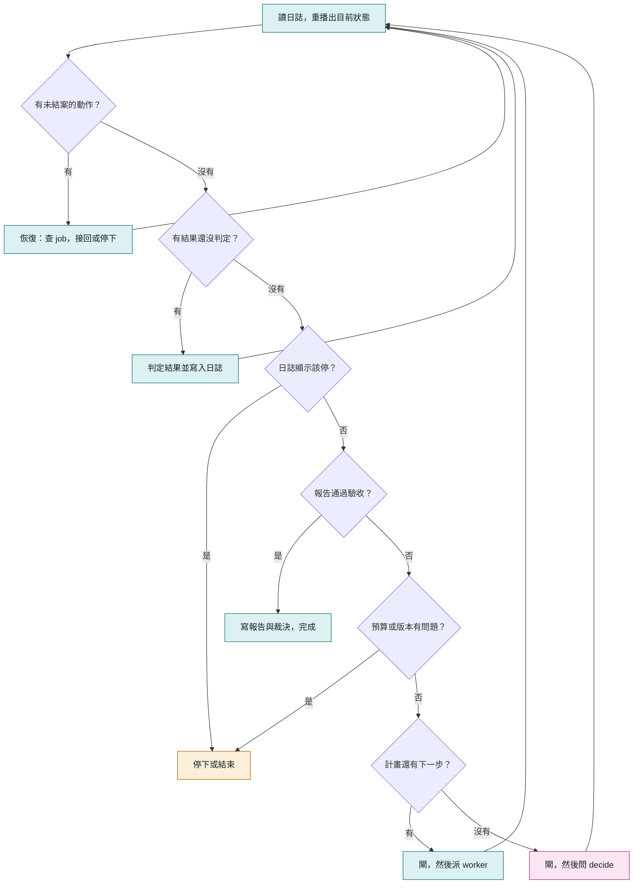

每一輪都從日誌重新開始，所以「當機後恢復」和「正常下一輪」走的是同一條路，沒有另一份恢復專用的邏輯。

### decide 能提什麼

decide 的回覆是提案，只有四種，格式不合就拒絕，連續兩次不合格 run 就失敗。

| 動作 | 意思 | kernel 怎麼處理 |
|---|---|---|
| `plan` | 接下來的步驟，最多 5 個 | 逐步過閘、派工 |
| `finish` | 指定已通過的步驟當最終報告 | 跑驗收 |
| `ask_human` | 目標不清楚 | 停下來問你 |
| `give_up` | 做不到 | run 失敗，記下原因 |

步驟只能有 `id`、`title`、`prompt`、`model` 四個欄位，多一個就拒絕。所以模型沒有欄位可以要權限，也改不了工作目錄。模型必須在委任書的 `allowedWorkerModels` 清單內。

worker 的輸出送給 decide 時會包在 `<worker_output untrusted="true">` 裡。裡面寫了什麼指令都沒有授權效力，因為 decide 能提的動作只有上面四種，而且 worker 永遠是唯讀的。

## 先記意圖，再動作

這是整個設計的核心。每個動作寫三筆：意圖、啟動、結果。當機時看日誌停在哪一筆，就知道該怎麼辦。

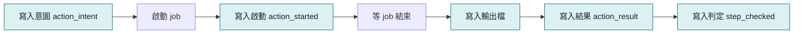

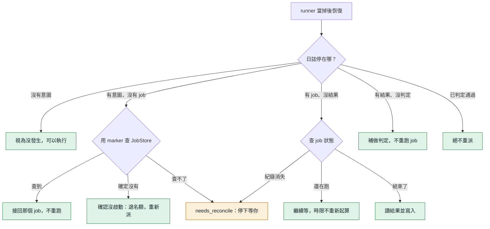

`marker` 是寫在 prompt 第一行的短字串，例如 `K-20261106021013b1b4-a2`。JobStore 的任務摘要只留前 40 個字元，所以 marker 必須夠短。

### 該不該停，也從日誌算

第一輪稽核抓到一個問題：「處理標記」和「停下來」原本分兩筆寫，當在中間就會漏掉人工閘。修法是把停下的決定和處理標記寫在同一筆，由 `derivedStop()` 從日誌算出來。迴圈每一輪都先看它，當機窗口就不存在了。

### 兩個 runner 同時活著怎麼辦

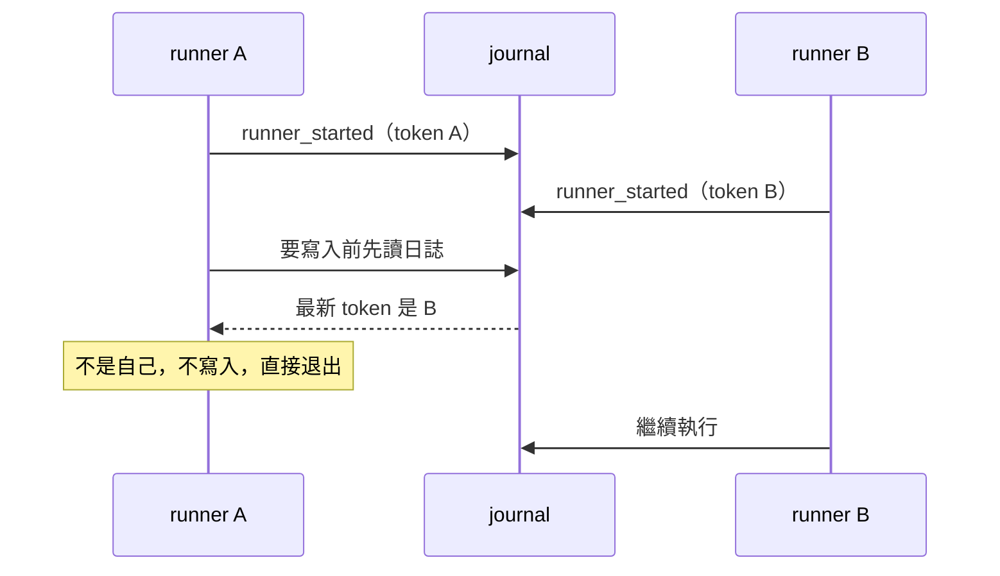

正常情況下 runner 鎖就會擋住第二個。fencing token 是第二道防線：鎖在極端的時間差下仍有機會被搶，這時只有最後啟動的 runner 算數。所有寫入都會先確認 token，舊 runner 就算正在等 job，回來時也寫不進去；退出時也只清自己的鎖，不會刪掉接手者的。

## 閘：派工前最後一關

閘只做確定性檢查，不呼叫模型。

| 檢查 | 條件 | 不通過時 | 可以用 approve 放行嗎 |
|---|---|---|---|
| 委任書 | digest 和核准時相同 | `failed` | 不行 |
| 別的 runner | fencing token 是自己 | 退出 | 不適用 |
| 程式版本 | dist 指紋沒變 | `version_drift` | 可以，接回 |
| 總時間 | 未超過 `maxWallMinutes` | `budget_exhausted` | 不行 |
| input tokens | 未超過 `maxInputTokens` | `budget_exhausted` | 不行 |
| worker、decide 次數 | 未超過上限 | `budget_exhausted` | 不行 |
| 權限探針 | 這支 CLI 是 PASS | `waiting_human` | 先跑 probe |
| 週額度偏低 | 剩餘不低於 `minQuotaRemainingPercent` | `waiting_human` | 可以 |
| 週額度未知 | 未超過 `quotaUnknownMaxDispatches` | `waiting_human` | 可以 |

**額度未知不等於還夠**，所以只能在委任書事先核准的保守上限內繼續。額度優先讀 raw 原文，因為百分比欄位的語意歷史上變過。

**token 預算只限制新增派工。** 已經在跑的 job 不會被中斷，所以可能超出一個 job 的量。第一次實戰就是 639,395／600,000，後來把預設值調高到 1,500,000。

## 三重裁決

授權、執行、交付是三個獨立判斷，不能互相代替。

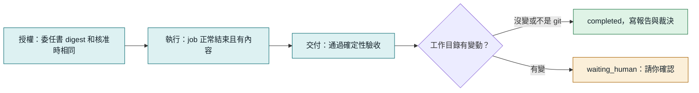

### readonly-audit 的驗收項目

每一項都是程式檢查，不呼叫模型。

| 檢查 | 內容 |
|---|---|
| `message_nonempty` | 回覆不是空的 |
| `no_refusal` | 不是「被政策拒絕、請貼上檔案」這類放棄訊息（只在回覆很短時才判） |
| `min_length` | 至少 80 字 |
| `required_sections` | 有「結論」「發現」「尚待確認」三個標題 |
| `citations_resolve` | 至少 1 個 `路徑:行號`，**而且每一個都實際打開檔案核對**，檔案不存在、行號超出範圍、跑出工作目錄都不通過 |

模型編出來的引用過不了最後一項。驗收連續兩次不過，run 就失敗，不會無限重試。

### 失敗分類

| 分類 | 例子 | kernel 的反應 |
|---|---|---|
| `rate_limited`、`quota` | 429、額度用完 | 立刻停下等人，重試沒有用 |
| `auth`、`model_unavailable` | 沒登入、模型不支援 | 立刻停下等人 |
| `empty_output` | exit 0 但沒有內容 | 回去問 decide，連續兩次就失敗 |
| `check_failed` | 步驟檢查不過 | 同上 |
| `process_failed`、`start_failed` | 非零結束、啟動失敗 | 同上 |
| `timeout` | 超過時限 | 停掉 job，同上 |
| `lost` | job 消失 | 同上 |

## 權限：能保證什麼

第一版只有「工具受限」，**不是隔離**。這點要講清楚。

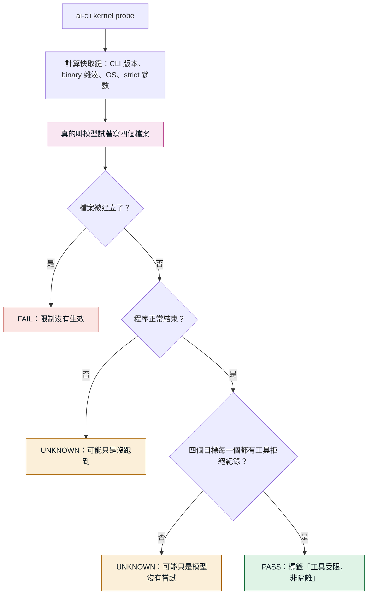

快取鍵任何一項變了，舊的 PASS 就失效。原因是 CLI 自動更新改過權限語義：Claude CLI 2.1.226 到 2.1.233 之間就發生過，當時靜默造成零交付。

證據的認定很嚴格，因為第二輪稽核發現舊版只要出現 `read-only` 字樣就算拒絕，模型沒試也能過。現在的規則：

- 只算工具層的拒絕：Codex 的 stderr 路由錯誤，或結束碼非 0 而且輸出明確寫被拒的指令。模型自己說「被拒絕了」不算。
- 寫了檔名的拒絕歸給該目標。`patch rejected` 這類沒寫檔名的分不出試了哪一項，只能替「編輯工具」那一項作證。第三輪稽核發現，否則模型把同一項重試四次，就能替沒試過的 shell 背書。
- 第一版只有 Codex 有實測過的格式（codex-cli 0.166.0，Windows）。Claude、Grok 照跑，檔案被建立仍會判 FAIL，但最多到 UNKNOWN，不假裝驗過。

模型有時候會拒絕嘗試。實際用的時候就撞到過，它回「我無法刻意嘗試繞過唯讀限制」。這不是工具擋住，也不是限制失效，所以：

- 判定為 UNKNOWN，而且**不會蓋掉之前驗出來的 PASS 或 FAIL**。一次沒結論不該把使用者擋下來。
- 自動再跑一次，只多一次。
- 提示詞講清楚這是授權的測試，被拒絕才是正確結果。改完後真實 Codex 連跑三次都通過。

### 各機制擋得住什麼

威脅分三級。T1 模型失誤：幻覺、改錯檔、假完成。T2 內容注入：讀到惡意內容後想用手上的工具做事。T3 蓄意逃逸：有 shell 的行程主動繞過限制。

| 機制 | T1 | T2 | T3 | 限制 |
|---|---|---|---|---|
| Claude `--disallowedTools` | 預防 | 預防 | 無效 | 是黑名單，會隨新工具過期 |
| Codex read-only（Windows） | 預防 | 預防 | 無效 | 沒有 OS 沙箱，靠安全指令清單 |
| 環境變數標記 | 預防 | 無效 | 無效 | 只擋合作式遞迴 |
| git 快照比對 | 偵測 | 偵測 | 偵測 | 看不到外傳、已還原的變更和被忽略的檔案 |
| 確定性驗收 | 預防 | 預防 | 無效 | 只防假完成，不防副作用 |

### 能承諾與不能承諾

| 能承諾 | 不能承諾 |
|---|---|
| 精確標示通過了哪些環境與操作的探針 | Windows 上的 vendor 唯讀模式等於隔離 |
| 空產出或缺驗收證據不結案 | 探針 PASS 就能防住所有注入與逃逸 |
| 授權、預算或結果不明時停止新增派工 | 取消或 diff 能撤回已經發生的外傳 |
| 受治理任務一次一個 | 全域額度保障；一般 `run` 不受管，直接啟動 vendor CLI 也在邊界外 |

## 主 session 關掉會怎樣

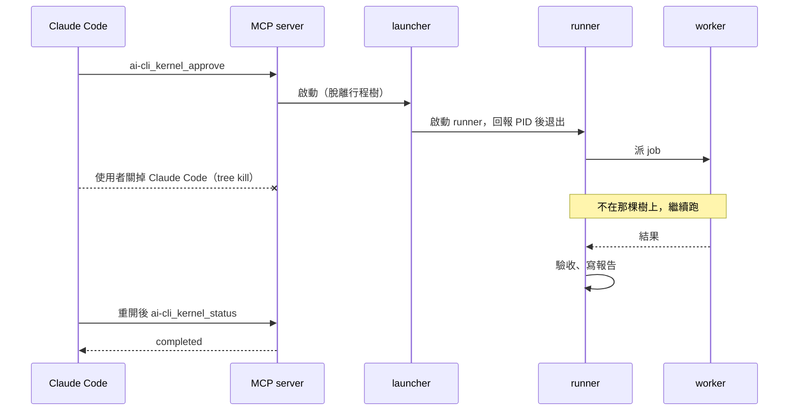

Windows 上 Claude Code 退出時會對 MCP server 做 `taskkill /T /F`，所以 runner 必須由短命的 launcher 啟動，才能脫離那棵行程樹。作法和原生 `core/job-launcher.ts` 相同。

## 取消與殭屍程序

過去發生過 `kill_process` 回 terminated 之後，舊 codex.exe 又活了約 25 分鐘，還 commit 並跑了 pytest。所以「回報已停止」不算數，要確認程序身分真的消失。

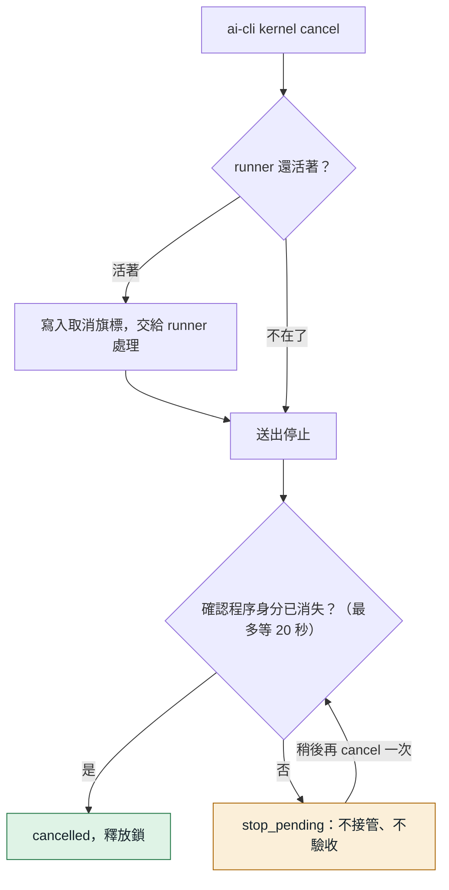

## 資料放哪裡

全部在 `~/.local/state/ai-cli/kernel/`（可用 `AI_CLI_STATE_DIR` 改）。

```
kernel/
  active.lock                受治理任務一次一個
  probes/<key>.json          探針結果，依 CLI 版本等快取
  runs/kr-20261106-021013-b1b4/
    contract.json            委任書，核准後不可變
    journal.jsonl            任務紀錄，事實以這裡為準
    outputs/a2.txt           每個動作的完整輸出
    report.md                最終報告，通過驗收才存在
    verdict.json             裁決
    runner.json              目前 runner 的身分
    runner.lock              防止同一個 run 有兩個 runner
    cancel.request           取消旗標
```

開關在 `~/.local/share/ai-cli/kernel.json`，只影響 MCP 工具有沒有出現。命令列一直都能用。

### 日誌事件

| 事件 | 意思 |
|---|---|
| `created` | 委任書建立，記 digest |
| `approved` | 核准或接回，可帶補充和放行項目 |
| `runner_started` | runner 啟動，記版本指紋與 fencing token |
| `baseline` | 工作目錄的基準快照 |
| `action_intent` | **要做某個動作，還沒做** |
| `action_started` | job 已啟動 |
| `action_result` | job 的結果 |
| `action_abandoned` | 放棄動作。`refund` 為 true 才退名額，只有確認沒啟動才是 true |
| `decide_processed` | decide 的回覆已判定，停下的決定也記在這筆 |
| `step_checked` | 步驟的判定結果 |
| `acceptance` | 最終報告的驗收結果 |
| `quota_unknown` | 在額度未知下派了一次工 |
| `state` | 狀態改變 |

最後一行寫到一半視為沒發生，下次寫入前截掉；中間的行損毀則拒絕解讀，不猜。

### 委任書的預算欄位

| 欄位 | 預設 | 意思 |
|---|---|---|
| `maxWorkerSteps` | 6 | 最多派幾個 worker |
| `maxDecides` | 5 | 最多呼叫幾次 decide |
| `maxWallMinutes` | 90 | 實際執行時間上限，等人的時間不算 |
| `maxActionMinutes` | 30 | 單一 job 時間上限 |
| `maxInputTokens` | 1,500,000 | 所有 job 的 input tokens（含快取） |
| `quotaUnknownMaxDispatches` | 2 | 額度量不到時最多再派幾次 |
| `minQuotaRemainingPercent` | 25 | 週額度低於這個百分比就停下問人 |

## 和當初規劃不同的地方

| 規劃 | 第一版 | 為什麼 |
|---|---|---|
| 固定版本目錄 | 偵測到 dist 變動就暫停 | updater 在原地重建 dist。要固定版本得連原生相依的 node_modules 一起複製，第一版先偵測，由人接回 |
| 一次核准 | 一樣，但 `worktree_changed`、低額度仍會問 | 這些是委任書當時看不到的新資訊 |
| 探針涵蓋三家 | 只有 Codex 能通過 | 依討論共識先支援一家。其他家的拒絕格式沒有實測過，不能假裝驗過 |

## 已知限制

- **只能唯讀。** 不能改檔、不能跑測試，那是 L2、L3 的事。
- **一次一個受治理任務。** 暫停中的 run 也佔著鎖，要接回或取消才會釋放。
- **一般 `run` 不受管。** 預算只算 kernel 派的 job。
- **快照看不到被 git 忽略的檔案。** 例如 `dist/`。
- **run 中斷太久可能拿不回結果。** JobStore 會回收已結束的 job，回收後接回只能進入 `needs_reconcile`。
- **Windows 只驗過這台機器。** Linux、macOS 的真實 CLI 沒有實測，只跑 stub 測試。
- **續接 Codex session 時 job 回報的 usage 是累計值。** kernel 目前都開新 session，所以不受影響，日後要續接時不能直接累加。
- **decide 的品質只有少量實測。** 目前只真跑過稽核任務。

## 路線圖

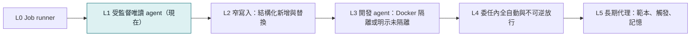

等級是交付里程碑，不是安全等級。完整討論見 [ai-cli Agent 化藍圖](https://claude.ai/artifact/4BXEbZu8oRYmDZr5GDjVv2)。

## 命令列與對照表

平常用說的就好。這一節給不透過 Claude、直接操作的人，以及要查細節的時候。

### 命令列流程

先在 PowerShell 設一個短指令。它只在目前的視窗有效，路徑換成你的 ai-cli 資料夾：

```powershell
function aik { node "<ai-cli 資料夾>\dist\bin\ai-cli.js" kernel @args }
```

| 動作 | 指令 |
|---|---|
| 檢查權限 | `aik probe --agent codex` |
| 建立任務（還不會執行） | `aik start --goal "要查什麼" --cwd "資料夾"` |
| 核准 | `aik approve <run>` |
| 等它跑完 | `aik wait <run>` |
| 看狀態（不給 run 就列出最近的） | `aik status <run>` |
| 看報告 | `aik result <run>` |
| 取消 | `aik cancel <run>` |
| 開關 MCP 工具 | `aik enable`、`aik disable` |

畫面上的 `ai-cli kernel` 就是這裡的 `aik`。`aik help` 會列出所有選項。

### start 的選項

| 選項 | 預設 | 意思 |
|---|---|---|
| `--effort` | medium | worker 的思考深度，`high` 比較仔細也比較貴 |
| `--max-steps` | 6 | 最多派幾個 worker |
| `--max-minutes` | 90 | 最多跑幾分鐘 |
| `--max-tokens` | 1500000 | 最多用多少 input tokens |
| `--allow-unverified` | 關 | 探針沒過也照跑，報告會標明未驗證。其他家（Claude、Grok）目前要加這個 |

### 實際用量

Codex gpt-6.1-sol，每次都是一個決策加一個 worker：

| 任務 | effort | input tokens（多半命中快取） | 時間 |
|---|---|---|---|
| 讀一份文件 | medium | 約 6 萬 | 5 分鐘 |
| 單檔稽核 | medium | 約 38 萬 | 3 分鐘 |
| 整個目錄稽核 | high | 約 50～64 萬 | 4～5 分鐘 |

五輪討論、五次任務和十來次探針加起來，Codex 週額度從 `49% used` 變成 `52% used`（這個數字只到整數位）。

### 狀態對照

狀態的最後一行「下一步」會告訴你該下什麼指令。

| 狀態 | 原因 | 意思 | 怎麼做 |
|---|---|---|---|
| `waiting_human` | `decide_question` | 看不懂目標，在問你 | `aik approve <run> --note "回答"` |
| `waiting_human` | `quota_low` | 週額度剩不到 25% | 要繼續就 `aik approve <run>` |
| `waiting_human` | `quota_unknown` | 查不到額度 | 要繼續就 `aik approve <run>` |
| `waiting_human` | `rate_limited` | 被限流 | 等一下再 `aik approve <run>` |
| `waiting_human` | `boundary_unverified` | CLI 更新過 | 先跑探針，再 `aik approve <run>` |
| `waiting_human` | `worktree_changed` | 跑的期間工作目錄被改 | `git status` 確認後 `aik approve <run>` |
| `interrupted` | | 背景程式不見了 | `aik approve <run>` 接回，做過的不會重做 |
| `version_drift` | | ai-cli 被更新 | `aik approve <run>` 接回 |
| `needs_reconcile` | | 分不出某個動作做了沒 | 用 `ai-cli jobs`、`git status` 確認後 `aik approve <run> --reconcile abandon` |
| `stop_pending` | | 舊程序還沒確認停止 | 稍等再 `aik cancel <run>` |
| `budget_exhausted` | | 預算用完 | 調高上限，重新 `aik start` |
| `failed` | | 連續失敗兩次 | 看「說明」，調整目標後重新 `aik start` |

### 錯誤訊息

| 訊息 | 意思 | 怎麼做 |
|---|---|---|
| `受治理任務一次只能跑一個` | 另一個任務還沒結束（暫停中的也算） | 等它跑完，或 `aik cancel` |
| `權限邊界探針結果是 UNKNOWN` | 還沒跑過探針，或 CLI 更新過 | `aik probe --agent codex` |
| `不在候選清單內` | 模型名稱打錯 | 改用正確名稱，或拿掉 `--model` |
| `走 direct-api，它沒有唯讀模式` | 第一版不能用 OpenRouter 這類 API | 改用預設模型 |
| `工作目錄不存在` | `--cwd` 打錯 | 確認路徑 |
| `AI_CLI_NESTED_DISPATCH_BLOCKED` | 在 ai-cli 派出去的 AI 裡面又叫它 | 防遞迴，正常不會碰到 |

### 裁決欄位

| 欄位 | 正常的值 | 意思 |
|---|---|---|
| `authorization.ok` | `true` | 委任書沒被改過 |
| `execution.ok` | `true` | AI 正常跑完 |
| `delivery.ok` | `true` | 通過所有檢查 |
| `readOnly` | `unchanged` | 工作目錄前後一模一樣 |

### MCP 工具

開啟後多出這些，原生的 `run`、`wait` 等不受影響：

| 工具 | 用途 |
|---|---|
| `ai-cli_kernel_start` | 建立委任書（教學手冊稱任務確認單） |
| `ai-cli_kernel_approve` | 核准或接回 |
| `ai-cli_kernel_status` | 看狀態 |
| `ai-cli_kernel_result` | 看報告 |
| `ai-cli_kernel_cancel` | 取消 |
| `ai-cli_kernel_probe` | 跑探針 |

## 驗證紀錄

| 驗證 | 結果 | 內容 |
|---|---|---|
| 故障語義測試 `verify-ai-cli_kernel.mjs` | 140 項全過 | 假執行器走遍各種當機位置，不花額度 |
| 端到端測試 `verify-ai-cli_kernel-e2e.mjs` | 39 項全過 | 真的走 CLI、runner、JobStore，真的殺掉 runner 再接回，也砍過 MCP server 整棵行程樹（模擬關掉 Claude Code），只把 vendor CLI 換成 stub |
| 完整 `npm test` | 33 支全過 | 既有 31 支都沒有被影響（探針重試的修正之前跑的，之後只重跑 kernel 的兩支） |
| 突變測試 | 35 筆全部被抓到 | 把每道防線逐一改壞，確認對應的斷言真的會失敗。最後一輪只重跑新增與修改過的 |
| 真實 Codex 探針 | PASS | codex-cli 0.166.0，Windows，四筆拒絕都對得上。修正提示詞後連跑三次都通過 |
| 真實 Codex 完整 run | 5 次都通過驗收 | 自主規劃、派工、驗收，工作目錄前後一模一樣 |

### 獨立稽核

依專案規則，由沒有寫這段程式碼的模型審查，意見逐條對照原始碼確認成立才修。三輪都是用 `ai-cli_kernel` 自己派工（gpt-6.1-sol，effort high）。

| 輪 | 範圍 | 找到 | 最嚴重的一條 |
|---|---|---|---|
| 1 | 核心迴圈、日誌、重播、驗收、runner | 6 項，都成立 | 兩個恢復程序能同時搶到 runner 鎖 |
| 2 | 第一輪沒讀到的檔案與修補本身 | 6 項，都成立 | 探針只要看到 read-only 字樣就判 PASS，模型沒試也能過 |
| 3 | 第二輪的修補與 `JobStore.start` 的新檢查 | 2 項，都成立 | 重複的匿名拒絕能替沒試過的 shell 背書；讀不到 job 清單被當成沒有 |

全部修掉並加上回歸測試與突變。**第三輪的修補沒有再經過第四輪獨立稽核。** 三輪都是靜態審查，競態的實際發生率沒有測過。第三輪的報告也寫明，額度用完時還有部分分支沒有核對完。

突變測試還抓到 2 筆假綠燈：測試資料太弱，有沒有那道防線都會過。已補強測試後重驗。

### 怎麼重跑

```text
npm run build
node tests/verify-ai-cli_kernel.mjs
node tests/verify-ai-cli_kernel-e2e.mjs
node tools/mutation-test.mjs --script verify-ai-cli_kernel.mjs --name kernel
```

突變測試不能和 `npm test` 同時跑，兩者會搶暫存的 git 資源。不給路徑時它測的是 HEAD，未 commit 的改動不在裡面。
