# ai-cli_kernel 技術手冊

給要理解或修改 `ai-cli_kernel` 的人。怎麼使用請看[教學手冊](./教學手冊.md)。

**現況：** 7.0.0 原始碼已含 L1、L3、L4、L5，尚未發佈到 npm；只在一台 Windows 上驗過，Linux、macOS 尚未實測。`readonly-audit` 是受監督唯讀 agent；`develop` 是「明示未隔離」的開發 agent，在獨立的 worktree 和分支交付（不是權限沙箱），kernel 自己跑測試驗收；回復點和單次放行處理不可逆動作；委任範本、主動觸發、記憶和歸檔包讓它能長期跑。L2 窄寫入和 Docker 隔離跳過了，理由見「develop 範本」。

## 全螢幕 dashboard 與共用規則

入口是 `kernel dashboard [--new-tab]`、`kernel actions <run> --json`。`actions` 按既有 CLI 慣例輸出 JSON 陣列，每個操作含 `id`、`runId`、`label`、`summary`、`warning`、`args`、`commit`、`isRelease`。沒有可用操作時輸出空陣列。它是唯讀 CLI，沒有新增 MCP 工具；模型沒有面板操作的 MCP 入口。

- `dashboard-rules.ts`：核對既有側邊面板後移植 `actionsFor`、`triggerAction`、狀態／原因／範本／步驟標籤、`chooseRun`、`progressLine` 等純規則。CLI 操作清單與面板只用這一份；外部側邊面板此次不修改。詳情目標保留多行原文，列表仍只取首行。沒有通過測試的 commit 時不提供合併／推送；只有推往預設分支才加 `--allow-default-branch`，包括交付分支本身就是預設分支的情況。
- `dashboard-view.ts`：純畫面組裝，外來文字先移除 ANSI／控制字元，之後才套用內部受信任的 SGR 樣式。沿用 `app/jobs.ts` 的 CJK／全形區間規則，避免直接引入其 process-service I/O 依賴；以 grapheme 保留組合字、ZWJ emoji。中文兩格，換行、裁切、填補均依顯示寬度，留最後一欄避免 autowrap。顯示缺值及全部詳情標籤；目標／報告不設總長度上限。寬度至少 101 欄左右分欄，其他為單欄，至少需要 21×10；確認內容放不下時禁止 y，要求放大。
- `dashboard.ts`：可注入 `DashboardEffects` 的控制器和 `perform`，不操作真實終端機。單飛刷新合併重複要求，generation 拒收舊 detail；失敗保留資料與成功時間。新 active run 出現時自動追蹤，人工選擇則固定到下一筆新 active；確認時不換目標，也不消耗新的 active 事件。報告為獨立按鍵模式，Esc 返回。
- `dashboard-api.ts`：直接使用 `api.ts`，不呼叫 CLI 子程序。只用 `execFile` 參數陣列查 git 目前分支／遠端預設分支，失敗留未知值；所有既有權限、ref、測試和單次放行檢查仍由原 API 執行。報告透過 result API 讀取完整內容。
- `dashboard-terminal.ts`：隔離 TTY、alternate screen、輸入解碼、訊號、timer、stdout 排空與新分頁啟動器。終端機、clock、新分頁查找／啟動皆可替換供測試。active 時 5 秒、閒置 30 秒，在刷新或操作完成後調整；不建立重疊資料請求。

### 確認與放行

所有改動，包括自動觸發開關，都先保存確認時的 run、操作參數及完整 verified commit（包含缺值），第一次按鍵不執行。只有小寫 y 通過；n／Esc 取消，其餘鍵不透傳。執行中防重入。按 y 重新查該 run，重算 actions 並比對 id、run、args、commit、isRelease 及確認時的 verified commit；查詢失敗、操作失效、commit 改變均阻止執行。總開關亦先重讀狀態核對。

放行只走原有 release create → 驗證回傳 id 屬於本 run 且符合既有格式 → release run。create 失敗、id 缺失／不可靠、run 結果不明或未成功都回報錯誤，沒有自動重試；人工確認前先對帳。畫面中的指令僅用於檢閱，執行使用 API 結構化參數，並非 shell 指令字串。此確認不取代原 API 的最後檢查，也不是權限隔離。

### 終端機生命週期與退出碼

直接 dashboard 在 worker 或 stdin／stdout 任一非 TTY 時回 1，進 raw／alternate screen 之前就拒絕。啟動前記住 raw mode 與 paused 狀態；退出恢復原值，離開 alternate screen、顯示游標、停用本面板的 bracketed paste、清除自身 timer 與 listener，不移除其他 listener，不呼叫取消或終止 run 的 API。正常 q 回 0，Ctrl+C／SIGINT 回 130，SIGTERM 回 143，初始化中途失敗／未預期例外／未處理 rejection／輸出錯誤回 1。確認模式的 Ctrl+C 鍵不透傳，n／Esc 可取消；外部終止訊號仍清理。操作執行中拒絕重複操作；q／Ctrl+C 會等本次操作收尾後離開，避免把已核准的操作做成結果不明。

cleanup 可重入且逐項嘗試復原，stdout 空寫入 callback 排在既有輸出之後，最多等兩秒；排空失敗回 1。面板不呼叫 `process.exit()`，回傳結束碼給既有 CLI `exitAfterFlush` 收尾。不能捕捉的作業系統強制終止（如 SIGKILL）不在復原保證內。

### Windows Terminal 新分頁限制

`--new-tab` 先檢查 worker，通過後才處理啟動器；父行程可來自 pipe，不先要求父行程 TTY，新分頁內的 dashboard 再檢查 stdin／stdout。僅 `win32` 且 `WT_SESSION` 存在、PATH 找得到可執行的 `wt.exe`（含 Microsoft Store App Execution Alias）時嘗試，以 `spawn(file, args, {shell:false})` 執行 `wt -w 0 new-tab --title ai-cli_kernel --startingDirectory <cwd> -- <目前 Node> <原 execArgv> <目前 CLI 入口> kernel dashboard`。Node、runtime 參數、入口及工作目錄皆為獨立參數，支援含空白路徑，不猜入口、不帶回 `--new-tab`，不安裝或改用別的終端機。啟動器最多等五秒，回 0 代表 WT 接受要求，不保證新分頁的面板已成功初始化。

非 Windows、缺 `WT_SESSION`、找不到 `wt.exe` 回 2；worker、入口缺失、spawn 錯誤或 WT 非零回 1。環境不支援、找不到 WT 或啟動失敗時，fallback 在獨立一行印出 PowerShell `&` 指令，以單引號逐一引用目前 `process.execPath`、原 `execArgv`、依目前工作目錄解析的 CLI 實際入口及 `kernel dashboard`；內嵌單引號加倍，不依賴 PATH 上另一份 ai-cli，也不帶 `--new-tab`。入口未知時明講無法產生指令，不猜路徑。這些路徑不進 raw／alternate screen。其他終端機仍可手動執行一般 dashboard，但不支援一鍵開分頁。

PATH 搜尋保留順序、空項略過、引號路徑處理與同名目錄拒絕；每個候選以 `lstatSync` 確認一般檔案或符號連結，再用 `accessSync(X_OK)` 檢查執行存取。不寫死 WindowsApps 路徑，也不以 `existsSync` 或 `statSync().isFile()` 作為必要條件：Store alias 是 reparse point，本機觀察到 `statSync` 回 EACCES，卻能以 Node spawn 啟動。真正缺失仍維持「PATH 找不到 wt.exe，沒有啟動其他終端機。」及退出碼 2。

2026-11-08 已在 Windows、Node v24.15.0 實際驗證：PATH 找到 alias，`lstatSync().isSymbolicLink()` 為 true、`accessSync(X_OK)` 成功、`statSync` 為 EACCES；先以直接 Node spawn 觀察到 spawn 事件與 close 0，再使用本次編譯的 `nativeLaunch().findWt()`／`launch()`、正式 `shell:false` 選項啟動測試分頁，close 0。這是實際 Node 啟動證據，並非 PowerShell 或 mock 代替；只證明 WT 接受開分頁要求，未驗證新分頁中 dashboard 的真人操作。無個人路徑的本機觀察記錄在 Git 忽略的 `dashboard-evidence.log/native-alias-spawn.json`。Linux、macOS 及其他 Node 版本未實跑。

面板使用無依賴的 16 色 SGR：完成綠、執行中青、等核准／等你決定／中斷黃、失敗紅、取消／預算用完灰，清單與詳細狀態一致，保留文字標籤。選取列反白，內嵌狀態只還原前景色，避免中途關閉反白；依終端機預設前景／背景與反白搭配深淺背景，不固定 RGB 背景。區塊標題粗體、標籤暗色、值一般色，⚠ 警告紅色粗體，確認標題粗體黃色，實際指令獨立一行；操作結果成功綠、失敗紅，底部按鍵青色、說明暗色。

`NO_COLOR` 非空（包含字串 `0`）或 `TERM=dumb` 時完全不輸出 SGR；空 `NO_COLOR` 不禁色，互動必要的游標／alternate screen 控制仍保留。ANSI 不佔顯示格數，裁切以完整 SGR token 與既有 grapheme／中文雙格規則進行，不切半 escape 或組合字；有色畫面每行結尾 reset，包含裁切、空行與最後一行，cleanup 在離開 alternate screen 前還原樣式；無色模式不加入 reset。字元實際格數、色盤對比仍受終端機字型、Unicode 版本與主題影響，深淺主題尚未真人視覺驗收。

驗證使用 `tests/verify-ai-cli_kernel-dashboard.mjs`，列入固定 npm test；安全突變在 `tools/mutations.json`。定向編譯與注入回歸不等於 kernel 的完整 npm test 驗收。

`createDashboardEffects` 可注入 API、git 讀取與時間；預設仍直接使用正式 API。測試核對真正 adapter 的參數轉換、查 git 失敗時保留未知、cleanup／release 未成功時回報錯誤，並對照 CLI JSON 與 `dashboardActions`。`nativeLaunch` 可注入程序啟動器，測試正式的 `shell:false`、獨立 argv、stdio、逾時設定及 wt.exe 結束後返回的控制流程；自動化測試本身不啟動真實終端機；上述 Node alias 實測為另外的前景驗證。

開發中的未提交內容可用 `node tests/dashboard-mutations.mjs` 重現 dashboard 全組突變。它只在本文件目錄的 Git 忽略 `dashboard-evidence.log/` 複製快照，執行原樣的 `tools/mutation-test.mjs`，不建立 worktree／分支、不 commit。先跑完整 dashboard 基準，每筆突變均需編譯、由指定斷言殺死、來源 bytes 還原，最後解除 node_modules 連結並檢查主相依套件；日誌、SHA-256 與結果保留供查核。不要與 npm test 並行，也不要把 dashboard 定向組的結果當成整份突變清單都已實跑。八項需求及本次實際證據見 [dashboard 驗收紀錄](./驗收紀錄/dashboard.md)。

## 一張圖看懂

顏色代表誰在做決定：粉紅是模型，青綠是程式，橘色是人。

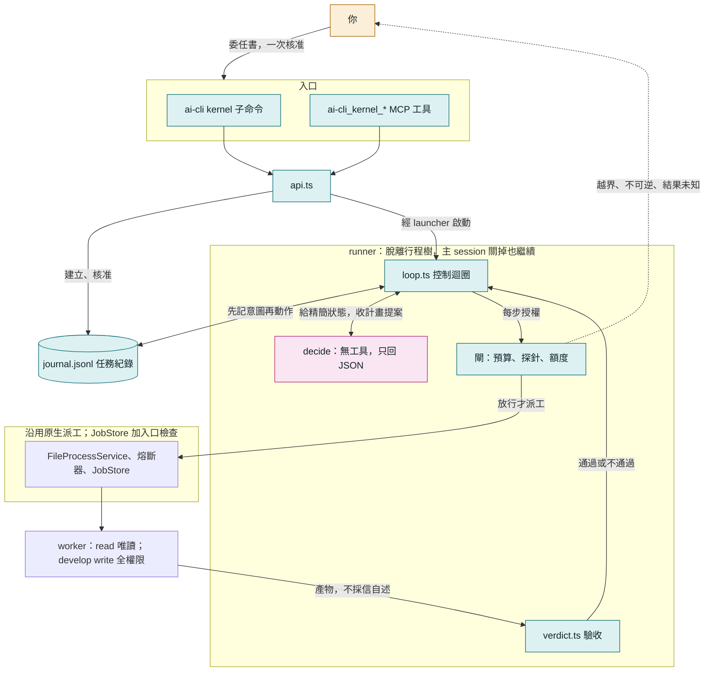

三個設計原則：

- **模型做決定，程式做限制。** 模型只提案，每一步能不能做由程式決定。
- **事實只在日誌裡。** 狀態、預算、該不該停，全部從 `journal.jsonl` 重算。
- **完成要有證據。** exit 0、completed、模型說做完了，都不算。

## 程式碼放哪裡

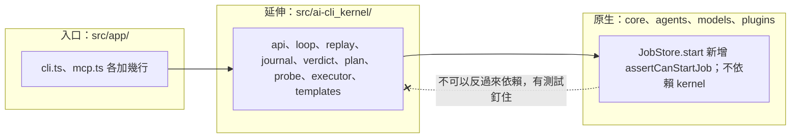

依賴只能往原生方向。這樣以後要拆成獨立套件時成本才低，原生工具介面保持相容；實際入口與行為變更見下節。

### 與既有 ai-cli 的整合範圍

以 v6.9.1 到本版的原文差異核對，kernel 在目錄外的整合為：`src/app/cli.ts` 新增 kernel 子命令、`src/app/mcp.ts` 註冊預設關閉的延伸工具，以及 `src/core/job-store.ts` 的 JobStore.start 新增 assertCanStartJob。core 不反向依賴 kernel，但不能說 core 完全沒改。

`src/core/worker-env.ts` 的判斷精確為：目前 ai-cli 行程環境的 AI_CLI_WORKER 等於字串 1，且 AI_CLI_ALLOW_NESTED 不等於字串 1，才拒絕啟動，錯誤為 AI_CLI_NESTED_DISPATCH_BLOCKED。原有 CLI run／exec 與 MCP run 已有入口防護；現在直接經 FileProcessService／ProcessService 到 JobStore.start 的呼叫也會被拒絕。一般未帶 worker 標記的主 session 不因這條檢查受阻；明示 AI_CLI_ALLOW_NESTED=1 可解除此派工限制，並非 kernel 的預算或安全保證。spawnPty 未加這條檢查，避免 runner 自帶 worker 標記時連已授權的 vendor 都不能啟動。這不是 OS 沙箱，不能攔截直接執行 vendor CLI 或環境標記未傳入的程序。

既有 MCP 工具名稱與參數介面沒有破壞性改動，但 7.0.0 也包含非 kernel 的 direct-api 設定錯誤路由、BOM、max_tool_loops 與 updater 待辦／面板提問改動，條件和遷移操作見 [CHANGELOG 7.0.0](../../CHANGELOG.md#700---2026-11-07)。

### 命名規則

原生名稱不動，延伸一律帶前綴，一眼分得出來。

| 位置 | 規則 | 例子 |
|---|---|---|
| 程式碼目錄 | `src/ai-cli_kernel/` | `src/ai-cli_kernel/loop.ts` |
| MCP 工具 | `ai-cli_kernel_<動作>` | `ai-cli_kernel_start` |
| 匯出函式 | `aiCliKernel<動作>`（TypeScript 名稱不能有連字號） | `aiCliKernelStart()` |
| 命令列 | `ai-cli kernel <動作>` | `ai-cli kernel start` |

### 各檔案的職責

| 檔案 | 職責 | 有沒有 I/O |
|---|---|---|
| `types.ts` | 資料形狀 | 無 |
| `replay.ts` | 把日誌重播成目前狀態，算出該不該停 | 無（純函式） |
| `journal.ts` | 任務紀錄的讀寫、全域鎖 | 有 |
| `verdict.ts` | 失敗分類、驗收檢查、git 快照 | 讀檔、git |
| `plan.ts` | decide 的提示詞與輸出解析 | 無 |
| `loop.ts` | 控制迴圈，依賴全部從參數傳入 | 透過參數 |
| `executor.ts` | 真實執行器，走原生 FileProcessService | 有 |
| `probe.ts` | 權限邊界探針 | 有 |
| `templates.ts` | 委任範本與模型檢查 | 少量 |
| `runtime.ts` | 版本指紋、額度讀取 | 有 |
| `runner.ts`、`launcher.ts` | 脫離行程樹的執行入口 | 有 |
| `runner-lock.ts` | 同一個 run 只能有一個 runner | 有 |
| `api.ts`、`cli.ts`、`mcp-tools.ts` | 對外入口 | 有 |

`replay.ts` 是純函式、`loop.ts` 的依賴都能替換，所以每一種當機位置都能用假執行器便宜地驗，不必花額度。

## 一個 run 會經過哪些狀態

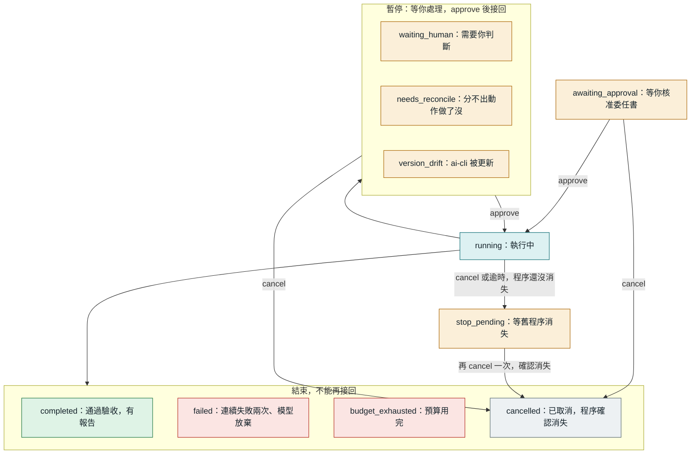

另外有一個不寫進日誌的顯示狀態 `interrupted`：日誌說 running，但 runner 程序已經不在。`approve` 就能接回。

## 控制迴圈

模型只站在 decide 一格。而且 decide 不是每步呼叫，只有失敗、驗收不過或計畫走完才回去，因為每次呼叫都有約 2～3 萬 token 的固定開銷。

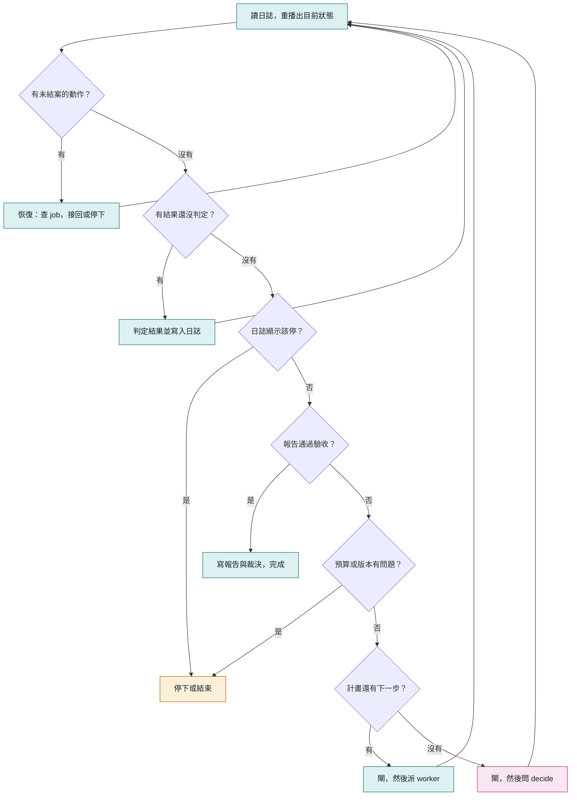

每一輪都從日誌重新開始，所以「當機後恢復」和「正常下一輪」走的是同一條路，沒有另一份恢復專用的邏輯。

### decide 能提什麼

decide 的回覆是提案，只有四種，格式不合就拒絕，連續兩次不合格 run 就失敗。

| 動作 | 意思 | kernel 怎麼處理 |
|---|---|---|
| `plan` | 接下來的步驟，最多 5 個 | 逐步過閘、派工 |
| `finish` | 指定已通過的步驟當最終報告 | 跑驗收 |
| `ask_human` | 目標不清楚 | 停下來問你 |
| `give_up` | 做不到 | run 失敗，記下原因 |

步驟接受 `id`、`title`、`prompt`、`model`、`mode`，額外欄位拒絕。`mode` 只能是 read／write：只有 develop 委任書允許 write；未填時 develop 預設 write、readonly-audit 預設 read。模型不能自行改工作目錄或突破委任書權限；所選模型必須在 `allowedWorkerModels` 清單內。plan／finish 另可附 lessons，只產生候選記憶。

worker 的輸出送給 decide 時會包在 `<worker_output untrusted="true">` 裡。裡面寫了什麼指令都沒有授權效力，因為 decide 能提的動作只有上面四種，decide 與 read 步驟始終受唯讀工具限制；develop 的 write 步驟則以使用者完整權限執行，不能把提示詞當成權限沙箱。

## 先記意圖，再動作

這是整個設計的核心。每個動作寫三筆：意圖、啟動、結果。當機時看日誌停在哪一筆，就知道該怎麼辦。

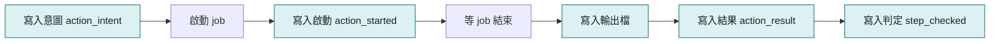

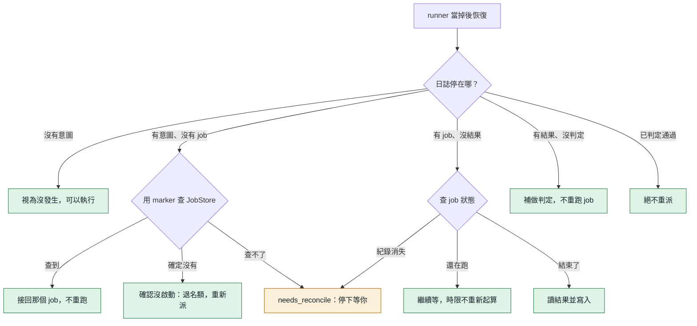

`marker` 是寫在 prompt 第一行的短字串，例如 `K-20261106021013b1b4-a2`。JobStore 的任務摘要只留前 40 個字元，所以 marker 必須夠短。

### 該不該停，也從日誌算

第一輪稽核抓到一個問題：「處理標記」和「停下來」原本分兩筆寫，當在中間就會漏掉人工閘。修法是把停下的決定和處理標記寫在同一筆，由 `derivedStop()` 從日誌算出來。迴圈每一輪都先看它，當機窗口就不存在了。

### 兩個 runner 同時活著怎麼辦

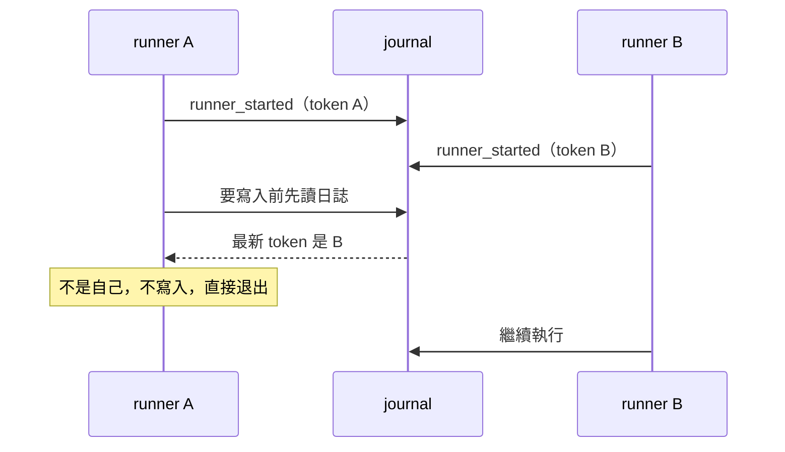

正常情況下 runner 鎖就會擋住第二個。fencing token 是第二道防線：鎖在極端的時間差下仍有機會被搶，這時只有最後啟動的 runner 算數。所有寫入都會先確認 token，舊 runner 就算正在等 job，回來時也寫不進去；退出時也只清自己的鎖，不會刪掉接手者的。

## 閘：派工前最後一關

閘只做確定性檢查，不呼叫模型。

| 檢查 | 條件 | 不通過時 | 可以用 approve 放行嗎 |
|---|---|---|---|
| 委任書 | digest 和核准時相同 | `failed` | 不行 |
| 別的 runner | fencing token 是自己 | 退出 | 不適用 |
| 程式版本 | dist 指紋沒變 | `version_drift` | 可以，接回 |
| 總時間 | 未超過 `maxWallMinutes` | `budget_exhausted` | 不行 |
| input tokens | 未超過 `maxInputTokens` | `budget_exhausted` | 不行 |
| worker、decide 次數 | 未超過上限 | `budget_exhausted` | 不行 |
| 權限探針 | 這支 CLI 是 PASS | `waiting_human` | 先跑 probe |
| 週額度偏低 | 剩餘不低於 `minQuotaRemainingPercent` | `waiting_human` | 可以 |
| 週額度未知 | 未超過 `quotaUnknownMaxDispatches` | `waiting_human` | 可以 |

**額度未知不等於還夠**，所以只能在委任書事先核准的保守上限內繼續。額度優先讀 raw 原文，因為百分比欄位的語意歷史上變過。

**token 預算只限制新增派工。** 已經在跑的 job 不會被中斷，所以可能超出一個 job 的量。L1 初次實戰曾記錄 639,395／600,000（當時尚未扣快取），不代表現行預算用量。現在預算計算為 input 減 cached；readonly-audit 預設 1,500,000，develop 預設 2,000,000。output 另列，不計入此上限；這不是美元帳單或供應商硬限額。

## 三重裁決

授權、執行、交付是三個獨立判斷，不能互相代替。

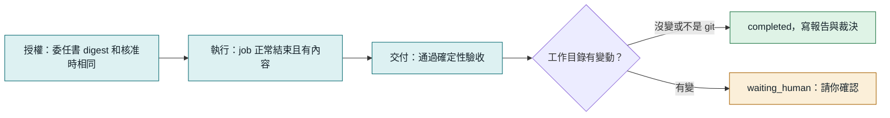

### readonly-audit 的驗收項目

每一項都是程式檢查，不呼叫模型。

| 檢查 | 內容 |
|---|---|
| `message_nonempty` | 回覆不是空的 |
| `no_refusal` | 不是「被政策拒絕、請貼上檔案」這類放棄訊息（只在回覆很短時才判） |
| `min_length` | 至少 80 字 |
| `required_sections` | 有「結論」「發現」「尚待確認」三個標題 |
| `citations_resolve` | 至少 1 個 `路徑:行號`，**而且每一個都實際打開檔案核對**，檔案不存在、行號超出範圍、跑出工作目錄都不通過 |

模型編出來的引用過不了最後一項。驗收連續兩次不過，run 就失敗，不會無限重試。

### 失敗分類

| 分類 | 例子 | kernel 的反應 |
|---|---|---|
| `rate_limited`、`quota` | 429、額度用完 | 立刻停下等人，重試沒有用 |
| `auth`、`model_unavailable` | 沒登入、模型不支援 | 立刻停下等人 |
| `empty_output` | exit 0 但沒有內容 | 回去問 decide，連續兩次就失敗 |
| `check_failed` | 步驟檢查不過 | 同上 |
| `process_failed`、`start_failed` | 非零結束、啟動失敗 | 同上 |
| `timeout` | 超過時限 | 停掉 job，同上 |
| `lost` | job 消失 | 同上 |

## 權限：能保證什麼

第一版只有「工具受限」，**不是隔離**。這點要講清楚。

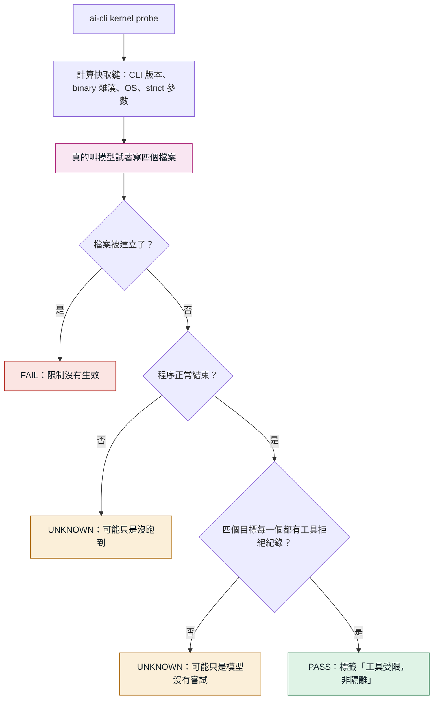

快取鍵任何一項變了，舊的 PASS 就失效。原因是 CLI 自動更新改過權限語義：Claude CLI 2.1.226 到 2.1.233 之間就發生過，當時靜默造成零交付。

證據的認定很嚴格，因為第二輪稽核發現舊版只要出現 `read-only` 字樣就算拒絕，模型沒試也能過。現在的規則：

- 只算工具層的拒絕：Codex 的 stderr 路由錯誤，或結束碼非 0 而且輸出明確寫被拒的指令。模型自己說「被拒絕了」不算。
- 寫了檔名的拒絕歸給該目標。`patch rejected` 這類沒寫檔名的分不出試了哪一項，只能替「編輯工具」那一項作證。第三輪稽核發現，否則模型把同一項重試四次，就能替沒試過的 shell 背書。
- 第一版只有 Codex 有實測過的格式（codex-cli 0.166.0，Windows）。Claude、Grok 照跑，檔案被建立仍會判 FAIL，但最多到 UNKNOWN，不假裝驗過。

模型有時候會拒絕嘗試。實際用的時候就撞到過，它回「我無法刻意嘗試繞過唯讀限制」。這不是工具擋住，也不是限制失效，所以：

- 判定為 UNKNOWN，而且**不會蓋掉之前驗出來的 PASS 或 FAIL**。一次沒結論不該把使用者擋下來。
- 自動再跑一次，只多一次。
- 提示詞講清楚這是授權的測試，被拒絕才是正確結果。改完後真實 Codex 連跑三次都通過。

### 各機制擋得住什麼

威脅分三級。T1 模型失誤：幻覺、改錯檔、假完成。T2 內容注入：讀到惡意內容後想用手上的工具做事。T3 蓄意逃逸：有 shell 的行程主動繞過限制。

| 機制 | T1 | T2 | T3 | 限制 |
|---|---|---|---|---|
| Claude `--disallowedTools` | 預防 | 預防 | 無效 | 是黑名單，會隨新工具過期 |
| Codex read-only（Windows） | 預防 | 預防 | 無效 | 沒有 OS 沙箱，靠安全指令清單 |
| 環境變數標記 | 預防 | 無效 | 無效 | 只擋合作式遞迴 |
| git 快照比對 | 偵測 | 偵測 | 偵測 | 看不到外傳、已還原的變更和被忽略的檔案 |
| 確定性驗收 | 預防 | 預防 | 無效 | 只防假完成，不防副作用 |

### 能承諾與不能承諾

| 能承諾 | 不能承諾 |
|---|---|
| 精確標示通過了哪些環境與操作的探針 | Windows 上的 vendor 唯讀模式等於隔離 |
| 空產出或缺驗收證據不結案 | 探針 PASS 就能防住所有注入與逃逸 |
| 授權、預算或結果不明時停止新增派工 | 取消或 diff 能撤回已經發生的外傳 |
| 受治理任務預設／硬上限 3 個，同 repo 1 個 | Claude 剩不到 10% 或未知退回全機 1 個；Codex 剩不到 20% 或未知禁止兩個含 Codex 的 run；一般 `run` 不受管 |

## 主 session 關掉會怎樣

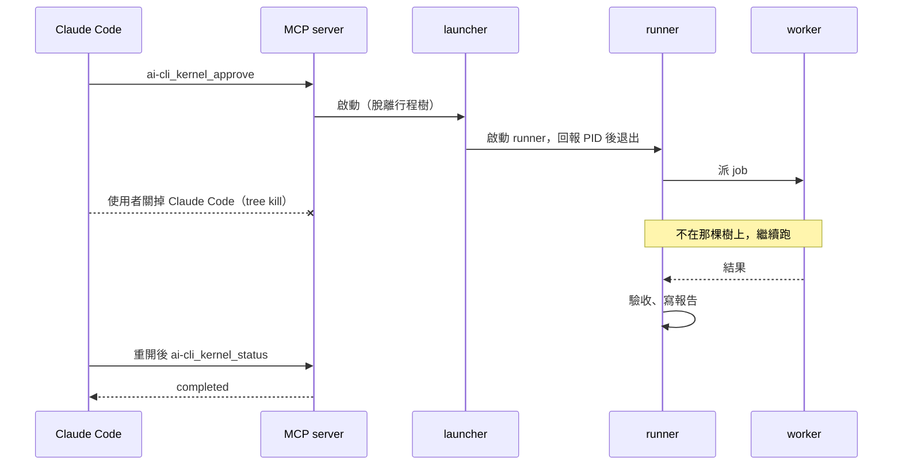

Windows 上 Claude Code 退出時會對 MCP server 做 `taskkill /T /F`，所以 runner 必須由短命的 launcher 啟動，才能脫離那棵行程樹。作法和原生 `core/job-launcher.ts` 相同。

## 取消與殭屍程序

過去發生過 `kill_process` 回 terminated 之後，舊 codex.exe 又活了約 25 分鐘，還 commit 並跑了 pytest。所以「回報已停止」不算數，要確認程序身分真的消失。

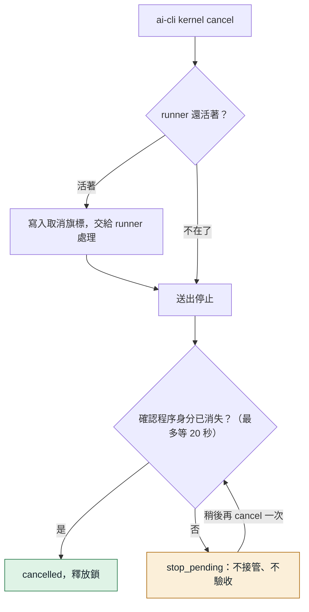

## 資料放哪裡

全部在 `~/.local/state/ai-cli/kernel/`（可用 `AI_CLI_STATE_DIR` 改）。

```
kernel/
  active-runs/               跨行程名額（預設／硬上限 3，同 repo 1）
  active.lock                新版名額的舊格式相容標記；真正舊 run 佔用另計並按 runId 去重
  concurrency.json           人用並行設定，MCP 無法修改
  test.lock                  全機 setup／test 指令共用的測試鎖
  probes/<key>.json          探針結果，依 CLI 版本等快取
  runs/kr-20261106-021013-b1b4/
    contract.json            委任書，核准後不可變
    journal.jsonl            任務紀錄，事實以這裡為準
    outputs/a2.txt           每個動作的完整輸出
    report.md                最終報告，通過驗收才存在
    verdict.json             裁決
    runner.json              目前 runner 的身分
    runner.lock              防止同一個 run 有兩個 runner
    cancel.request           取消旗標
```

開關在 `~/.local/share/ai-cli/kernel.json`，控制 MCP 工具列出與呼叫，命令列一直都能用。`AI_CLI_KERNEL=on|off` 優先覆寫檔案設定；其他環境值才回頭讀檔。

### 日誌事件

| 事件 | 意思 |
|---|---|
| `created` | 委任書建立，記 digest |
| `approved` | 核准或接回，可帶補充和放行項目 |
| `runner_started` | runner 啟動，記版本指紋與 fencing token |
| `baseline` | 工作目錄的基準快照 |
| `action_intent` | **要做某個動作，還沒做** |
| `action_started` | job 已啟動 |
| `action_result` | job 的結果 |
| `action_abandoned` | 放棄動作。`refund` 為 true 才退名額，只有確認沒啟動才是 true |
| `decide_processed` | decide 的回覆已判定，停下的決定也記在這筆 |
| `step_checked` | 步驟的判定結果 |
| `acceptance` | 最終報告的驗收結果 |
| `quota_unknown` | 在額度未知下派了一次工 |
| `state` | 狀態改變 |

最後一行寫到一半視為沒發生，下次寫入前截掉；中間的行損毀則拒絕解讀，不猜。

### 委任書的預算欄位

下表為 readonly-audit 預設；develop 覆寫為 worker 10 次、decide 8 次、180 分鐘、單一 job 45 分鐘、未快取 input 2,000,000。來源為 `templates.ts`；`loop.ts` 與 `api.ts` 均以 input 減 cached 計算預算用量。

| 欄位 | 預設 | 意思 |
|---|---|---|
| `maxWorkerSteps` | 6 | 最多派幾個 worker |
| `maxDecides` | 5 | 最多呼叫幾次 decide |
| `maxWallMinutes` | 90 | 實際執行時間上限，等人的時間不算 |
| `maxActionMinutes` | 30 | 單一 job 時間上限 |
| `maxInputTokens` | 1,500,000 | 所有 job 的未快取 input tokens（input 減 cached，不計 output） |
| `quotaUnknownMaxDispatches` | 2 | 額度量不到時最多再派幾次 |
| `minQuotaRemainingPercent` | 25 | 週額度低於這個百分比就停下問人 |

## 和當初規劃不同的地方

| 規劃 | 第一版 | 為什麼 |
|---|---|---|
| 固定版本目錄 | 偵測到 dist 變動就暫停 | updater 在原地重建 dist。要固定版本得連原生相依的 node_modules 一起複製，第一版先偵測，由人接回 |
| 一次核准 | 一樣，但 `worktree_changed`、低額度仍會問 | 這些是委任書當時看不到的新資訊 |
| 探針涵蓋三家 | 只有 Codex 能通過 | 依討論共識先支援一家。其他家的拒絕格式沒有實測過，不能假裝驗過 |

## L4 單次放行（第二階段）

`ai-cli kernel release create <run> --action merge|push --target <branch> --confirm <交付 commit 前 10 碼> [--remote origin] [--hours 1] [--allow-default-branch]`
只建立授權；`ai-cli kernel release run <id>` 才執行。CLI 呼叫 `api.ts` 的 `aiCliKernelReleaseCreate/Run`，由 `loop.ts` 的 deps 注入時間、ID、人員邊界、git 與儲存操作。沒有 release MCP 工具，不交給 decide，也不派 worker。worker 即使設定允許巢狀派工仍被拒絕；trigger run 禁用。

只接受日誌狀態為 completed 的 develop。建立和執行都重算委任書 digest，比對核准、驗收、最新 verification（passed、exit 0、未逾時）和交付 commit。交付分支 ref 必須仍指向該 commit，基準必須仍是祖先；啟用回復點時 ref 必須仍有效。清掉 worktree 後，只要交付分支還在，仍可放行。

`releases.jsonl` 存在 run 目錄，建立事件含規格欄位 `id/action/target/remote/commit/baseCommit/targetCommitAtCreate/expiresAt`，另固定 `remoteUrl` 與 `allowDefaultBranch`。ID 為 `<runId>-rel-<16 位十六進位亂數>`；未指定 hours 為 1，必須大於零。merge 的 target 必須已存在；push 可建立新分支，此時 targetCommitAtCreate 為 null。遠端限已設定的名稱，只有單一 push URL 且與查詢 URL 相同才接受，避免核對一個遠端卻推到另一個。

`replay.ts` 的 `aiCliKernelReplayReleases` 是純函式，從事件重建 available／succeeded／failed／unknown 與 attempted。先以排他 `release.lock` 序列化同一 run 的操作，再做全部前置核對；只有通過後才 fsync `release_intent`，再執行 git，最後 fsync `release_result`。意圖後沒結果即 unknown；失敗、逾時、例外或執行後 target 無法確認為交付 commit 都記 unknown，**永不自動重試**。殘行／損毀紀錄直接拒絕，不能像 job 日誌忽略最後半行。當機留下的鎖也不自動回收，須先人工確認舊程序已停止、核對本地與遠端及 releases.jsonl，再處理鎖；移除鎖不會清除已記錄的意圖或恢復授權。前置驗證失敗尚未產生意圖，因此不消耗授權。

merge 要求來源 repo 目前就在 target（不替人切換）、index／工作樹乾淨（含未追蹤檔），沒有未結束的 merge、rebase 等操作，才 `git merge --ff-only <commit>`。分歧不會產生合併 commit。push 用精確 `<commit>:refs/heads/<target>`，不帶 force，明確關閉 follow-tags、mirror 與遞迴推送子模組，避免既有設定擴大授權範圍。實測遠端的 mirror 設定會蓋過 `--no-mirror`，因此指令另外以 `git -c remote.<name>.mirror=false push ...` 限制這一次執行，不寫入使用者設定。

push 建立與執行都即時 `ls-remote --symref <remote> HEAD` 確認預設分支；target 等於預設分支需在 create 額外加 `--allow-default-branch`，訊息寫明可能等於部署。同意隨授權保存；執行時如果原本的普通分支變成預設分支，也會拒絕未含此同意的授權。無法取得預設分支（含空的 bare repo）時保守拒絕。

仍有邊界：release.lock 只協調 kernel 同一 run，不鎖住其他人的 git。`ls-remote` 核對與一般無強制 push 之間無法原子比較遠端舊值；一般 push 會阻擋非快轉，但無法阻擋所有並行快轉競態。規格禁止 force，因此未使用 force-with-lease。git hooks 和使用者全權限配置也不受隔離。需在 release 期間避免同時改交付分支與目標；未實跑項目見 [第二階段驗收](./驗收紀錄/L4-第二階段驗收.md)。

## develop 範本

`readonly-audit` 以工具限制約束讀取，仍不是 OS 沙箱。`develop` 的 worker 要改檔，所以保證的方式完全不同：不預防，而是把交付關在一條分支上，由程式事後查核。

### L4 第一階段：回復點與 rollback

新委任書的 `develop.checkpoint` 是 `{ mode: 'push' | 'local' | 'off', remote: string | null, ref: string }`。
有 `origin` 預設 `push`，沒有則 `local`；`--checkpoint` 可明確選擇。只備份到專用的
`ai-cli_kernel/checkpoints/<runId>`，不推使用者的分支或交付分支。委任書、狀態、報告與裁決都顯示回復點。
`off` 必須是人手動核准的 run；觸發 run 不能用，也不能在遠端備份失敗後降成本地。

loop 在建立工作區、執行準備指令與派模型之前，透過 `WorkspaceOps` 建回復點：

1. 暫存 index 執行 `read-tree HEAD`、`add -A`、`write-tree`。包含未提交與未追蹤的檔案，遵守 `.gitignore`；不改來源 HEAD、index 或檔案。來源 HEAD 已離開委任書基準則暫停，要求重建委任書。
2. tree 相同直接使用 HEAD；不同則 `commit-tree -p HEAD`。先記 `checkpoint_prepared`，再以 compare-and-swap 建專用 ref；已存在則驗證，不覆寫。
3. 備份前以 `--no-renames` 比較快照與基準的路徑。任一路徑段符合 `.env`／`.env.*`、`*.pem`、`*.key`、`id_rsa`、`credentials*`、`*secret*`（不分大小寫）就停在 `checkpoint_secret_risk`，完全不傳送、不派工。這是檔名檢查，沒有掃描內容。
4. 先查遠端專用 ref；已指向同一 commit 表示前次已備份成功，直接沿用。不同則拒絕。不存在才以一般推送建立專用 ref，不強制覆寫。失敗停在 `checkpoint_push_failed`；人手動建立的 run 經 `approve` 同意後只留本地，裁決的 `checkpointMode` 記 `local`。
5. 完成記 `checkpoint` 事件 `{ commit, ref, pushed, remote }`。`pushed: false` 表示本地模式或未確認備份，不能據此推斷遠端一定沒有該 commit。

重播是純函式，只由事件還原 `checkpointPrepared` 與 `checkpoint`。當在記錄、建 ref、遠端備份、記完成事件之間時，沿用原 commit；備份成功但尚未落盤由遠端查詢對帳。`refs()` 排除回復點與其 remote-tracking ref；最終驗收及交付前另外驗證本次回復點仍指向原 commit，刪除或改動都不能交付。
舊委任書沒有 `checkpoint` 時維持舊行為，不改 digest，也不在接回時新增未核准的遠端操作。

`ai-cli kernel rollback <run>` 預設只印安全的分支還原指令。
加 `--apply` 只建立 `restore/<run>` 分支，不切換、不改 index 或工作樹；同名分支、回復點已變動或沒有回復點均拒絕。
遠端備份失敗而停住的 run 也可從已準備且仍存在的本地 ref 還原。

工作包一 A 的驗收見回復點紀錄；目前 release 單次放行與 L5 範本／觸發已接續完成，詳見後面的對應章節。記憶與歸檔包屬工作包三，現已完成，詳見後文 L5 第二部分。
驗收斷言與實測結果見 [L4 第一階段驗收](./驗收紀錄/L4-第一階段驗收.md)。

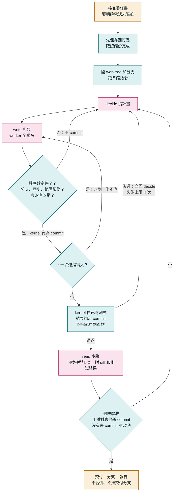

### 為什麼跳過 L2、也不先做 Docker

藍圖原本的順序是 L2 窄寫入，再到 L3。使用者要的是能開發，而 L2 只能換文字、不能跑測試，滿足不了。Docker 要處理訂閱 CLI 的登入憑證，也沒有實測過，會慢很多。藍圖討論時已經收斂出「明示未隔離」是可接受的模式，條件是寫明範圍、預算、期限，所以直接做它。

代價是**這個模式沒有隔離**，風險和直接用 `run` 派寫入工作一樣。

### 能保證什麼

下表的 ref 查核排除專用回復點及其遠端追蹤 ref。回復點本身另外驗證；遠端備份只發生在開工前的專用分支。

| 查核 | 怎麼做 | 查不到什麼 |
|---|---|---|
| 交付通過測試 | kernel 自己跑 `testCommand`，結果綁定 commit，HEAD 一動就失效 | 測試沒涵蓋的行為 |
| 改動在範圍內 | `allowedPaths` 比對相對基準的所有改動，**查完才 commit** | 工作目錄以外的寫入 |
| 分支和歷史沒被動 | 查目前分支、基準 commit 還是祖先 | |
| 其他分支、tag 沒動，沒有 push | 派工前比對 refs，動過就停下來；交付前動過就寫進報告 | `git push <url>` 這種不更新 remote-tracking ref 的；以及已經發生的外傳 |
| 主目錄沒被改 | 交付前比對快照，有變動就寫進報告和裁決，不擋交付 | 分不出是使用者自己、hook 還是 worker。第一次真實的自動 run 就因為 planner hook 寫了 `.planner-id` 而卡在最後一步，所以改成提醒 |
| 舊程序停了才動工作目錄 | 查程序身分；當掉後先停掉上次的測試指令 | |

全權限 worker 能在查核之前做任何事，**這些查核抓得到多數意外，防不了蓄意或被文件注入後的操作**。

### 使用者的 hook 管得到誰

| 誰在動作 | 全域 hook | 專案 hook | 依據 |
|---|---|---|---|
| Codex 寫入 worker | 會 | **很可能不會** | 全域：實測 `git reset --hard`、`git clean -fd` 被 PreToolUse 擋下，對照組正常（codex-cli 0.166.0）。專案：信任紀錄綁 `hooks.json` 的絕對路徑，worktree 是新路徑，未信任的 hook 會被 `codex exec` 跳過。這條是推論，沒有實測 |
| Claude 寫入 worker | 應該會 | 有進版控的才會 | 推論，沒有實測。被 git 忽略的設定檔不在 worktree 裡 |
| Codex 唯讀（decide、read 步驟） | 不會 | 不會 | 帶 `--ignore-user-config`；實測 decide 跑完時 SessionStart 沒有觸發 |
| Grok | 沒查 | 沒查 | |
| kernel 自己（測試、commit、reset、clean） | 不會 | 不會 | 不經過 AI 工具。git 自己的 commit hook 照跑 |

所以 kernel 自己跑的 `git reset --hard`、`git clean -fd` 寫進委任書的 `notices`，核准時等於同意。repo 有 `.codex/hooks.json` 而且會用到 Codex 時，也會寫進去。

hook 比對的是指令文字。worker 可以把指令寫進測試腳本，再由 kernel 代跑，不會經過 hook。**hook 防失誤，不是隔離。**

### 權限只有一條路會放寬

`executor.ts` 只有在 `mode === 'write'`、委任書有 `develop`、而且 cwd 在 worktree 內時才不帶 capabilities。其他情況一律走 strict builder，缺任何一個條件就拒絕啟動。decide 和 read 步驟始終是唯讀。

`develop` 不看探針：探針證明的是「工具受限」，這裡已經明示未隔離，不該拿它當放行條件。

### 測試何時跑

- 下一步是寫入：不跑，改到一半本來就可能是壞的。
- 下一步是審查、或計畫走完、或報告步驟通過：只要有新 commit 就跑。

要先測再審，有兩個原因：測試沒過的東西不值得花額度審查；審查者也才看得到結果。第一次真實 run 曾經順序相反，審查者寫「測試尚未核對」，頁尾卻寫通過，報告自相矛盾。

測試跑完會在 worktree 裡做 `git reset --hard` 和 `git clean -fd`，避免副產物混進下一次 commit。這兩個指令會丟改動，所以 `assertOwnWorktree` 強制只能是這個 run 自己的 linked worktree，不能是主目錄。此時改動都已經 commit，被清掉的只有測試產物；被 git 忽略的 `node_modules` 會留著。

### 準備指令

新 worktree 沒有被忽略的檔案，所以多半要 `setupCommand`。它留下沒被忽略的改動（例如 `npm install` 改了 lockfile）就會停下來，否則那些東西會被下一次 commit 一起交付，而且不是任何 worker 改的。

### 多模型

`workerModels` 列出 decide 可以挑的模型，寫入和審查都能用。全部走 ai-cli 原本的派工，所以都算進預算和日誌。

- worker 自己再呼叫 ai-cli 是刻意不開的：會撞上防遞迴，也不會算進預算。
- OpenRouter 這類 direct-api 這次沒開：它會把程式碼送到外部 API，也沒有唯讀模式。
- effort 目前所有 worker 共用一個值。

### 實際觀察

以下是 scratch repo 上的一次真實 run（codex-cli 0.166.0、gpt-6.1-sol medium、grok-4.7 medium，Windows），任務是加一行程式：

| 動作 | input tokens | 其中快取 |
|---|---|---|
| decide | 20,091 | 12,416 |
| Codex 寫入 | 155,129 | 114,432 |
| Grok 唯讀審查（當時沒有 diff，要自己找） | 533,800 | 449,152 |

寫入 worker 的固定開銷比唯讀高很多，因為它載入使用者完整設定，包含所有 MCP 工具。這也帶來下面第一條限制。

## 卡住時要刪什麼

鎖的原則是**寧可卡住也不要猜**：程序被強制終止時可能留下來。名額／測試鎖按下方並行規則查證身分後回收；其他未提供自動回收的鎖，須先確認沒有程序在用，再人工處理。都在 `<狀態目錄>/kernel/` 底下。

| 症狀 | 檔案 | 要先確認 |
|---|---|---|
| 觸發一直回報 `trigger_busy` | `triggers.lock` | 沒有 `kernel trigger` 在跑 |
| 放行回報「放行鎖已被佔用」 | `runs/<run>/release.lock` | 上次的放行結果。`unknown` 不能改回可用，要自己查 git 再決定 |
| 記憶或範本寫入失敗 | `memory/<repo>.jsonl.lock`、`mandates/<name>.json.lock` | 沒有別的指令在改 |
| 名額滿、同 repo 或額度不足 | `active-runs/`、舊 `active.lock` | 看錯誤中的佔用 run；等其結束或明確取消，不刪活鎖；被擋立即回錯，不排隊 |
| 「等測試鎖」 | `test.lock` | 正常等待 setup／test；可取消，不能因 runner 消失就刪除仍有命令活著的鎖 |
| 帳本殘行、記憶殘行 | `triggers.jsonl`、`memory/<repo>.jsonl` | 最後一行可能是扣帳或撤銷，看過再修，不能直接刪檔 |

## 已知限制

- **全權限 worker 可以自己呼叫你的 MCP。** kernel 自己的程式沒有路徑寫入 Planner 或 Knowledge，但 worker 會載入你完整的設定，它有能力呼叫 `knowledge_write` 這類工具，只有提示詞叫它不要。要真的擋住得改 worker 的啟動參數，那是原生 agent 的範圍，還沒做。
- **kernel 自己 push 不經過你的 hook。** 回復點和放行是 kernel 程式跑的 git，你的 PreToolUse hook 和 CI 關卡看不到。回復點只推專用分支，放行只有人能建立，但沒有第二道關卡。
- **授權檢查還有幾毫秒的窗口。** 觸發開工和 merge 放行都在動手前最後再查一次，但查完到動手之間無法完全消除。
- **突變沒有全部跑過。** 完整清單以 `tools/mutations.json` 為準，不能把定向抽驗視為全量結果。L4、L5 的突變由開發的 worker 用定向腳本跑過，主 session 只抽查了最關鍵的幾筆。

- **準備指令仍須可重複執行。** setup／test 已透過監督程序、持久測試鎖與開工握手保護：先保存程序身分，才允許實際命令開始。準備指令成功後、`workspace_ready` 落盤前當掉，接回仍可能再跑一次；強殺監督程序卻留下孫程序的情境尚待實測。
- **只確認 worker 本身和 runner 停了。** 它留在背景的子孫程序不在查核範圍內。
- **`allowedPaths` 區分大小寫。** Windows 上寫 `SRC` 會把 `src/a.ts` 擋下來。這只會多擋，不會放行，所以沒有修。
- **`develop` 的 worker 會載入使用者的完整設定。** 包含 MCP server 和 hook，所以它能用你的 planner、knowledge 等工具。實測在沒登記過的 repo 跑時，planner 的 SessionStart hook 自動註冊了新專案，並在主目錄寫了 `.planner-id`。kernel 只會在交付時發現主目錄變了並停下來問人，撤不回 planner 上的紀錄。
- **`develop` 沒有隔離。** 見上面「能保證什麼」。
- **`develop` 只驗過一台 Windows。** Linux、macOS 尚未實測；有 stub 測試不等於已在這兩個平台執行。
- **`readonly-audit` 的探針範圍比藍圖窄。** 只試工作目錄內 3 種寫法，絕對路徑、`..`、junction、文件注入都沒測。
- **受治理任務最多 3 個，同 repo 1 個。** 暫停、中斷、等人仍佔名額，待核准不佔；額度不足或未知會收緊新名額，既有 run 不被強停。見下方並行規則。
- **一般 `run` 不受管。** 預算只算 kernel 派的 job。
- **快照看不到被 git 忽略的檔案。** 例如 `dist/`。
- **run 中斷太久可能拿不回結果。** JobStore 會回收已結束的 job，回收後接回只能進入 `needs_reconcile`。
- **Windows 只驗過這台機器。** Linux、macOS 尚未實測；stub 測試不能作為這兩個平台的實跑結果。
- **續接 Codex session 時 job 回報的 usage 是累計值。** kernel 目前都開新 session，所以不受影響，日後要續接時不能直接累加。
- **decide 的品質只有少量實測。** 已有稽核與 scratch repo 開發的觀察，不代表一般專案品質保證。

## 路線圖

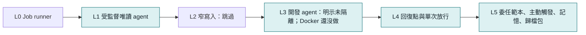

等級是交付里程碑，不是安全等級。公開規格見 [L4／L5 規格](./L4-L5-規格.md)。

## 命令列與對照表

平常用說的就好。這一節給不透過 Claude、直接操作的人，以及要查細節的時候。

### develop 的命令列

```powershell
aik start --template develop --goal "要做什麼" --cwd "repo" --test "npm test" --setup "npm ci" --allow-path "src,tests" --worker-models "sonnet,grok-4.7"
aik approve <run> --acknowledge-unisolated
aik wait <run>
aik result <run>
git merge ai-cli_kernel/<run>
aik cleanup <run>
```

| 選項 | 說明 |
|---|---|
| `--test` | 必填。kernel 自己跑的驗收指令 |
| `--setup` | 新 worktree 要先跑的準備指令 |
| `--allow-path` | 只能改這些路徑，相對 `--cwd`，逗號分隔。不給就是整個 repo |
| `--worker-models` | 另外允許 decide 挑選的模型，逗號分隔 |
| `--mandate-hours` | 委任書幾小時後失效，預設 24 |
| `--max-test-failures` | 測試失敗幾次就停，預設 4 |

預設預算：worker 10 次、decide 8 次、180 分鐘、單一 job 45 分鐘、未快取 input tokens 200 萬。

### 命令列流程

先在 PowerShell 設一個短指令。它只在目前的視窗有效，路徑換成你的 ai-cli 資料夾：

```powershell
function aik { node "<ai-cli 資料夾>\dist\bin\ai-cli.js" kernel @args }
```

| 動作 | 指令 |
|---|---|
| 檢查權限 | `aik probe --agent codex` |
| 建立任務（還不會執行） | `aik start --goal "要查什麼" --cwd "資料夾"` |
| 核准 | `aik approve <run>` |
| 等它跑完 | `aik wait <run>` |
| 看狀態（不給 run 就列出最近的） | `aik status <run>` |
| 看報告 | `aik result <run>` |
| 取消 | `aik cancel <run>` |
| 開關 MCP 工具 | `aik enable`、`aik disable` |

畫面上的 `ai-cli kernel` 就是這裡的 `aik`。`aik help` 會列出所有選項。

### start 的選項

| 選項 | 預設 | 意思 |
|---|---|---|
| `--effort` | medium | worker 的思考深度，`high` 比較仔細也比較貴 |
| `--max-steps` | 6 | 最多派幾個 worker |
| `--max-minutes` | 90 | 最多跑幾分鐘 |
| `--max-tokens` | 1500000 | 最多用多少 input tokens |
| `--allow-unverified` | 關 | 探針沒過也照跑，報告會標明未驗證。其他家（Claude、Grok）目前要加這個 |

### 實際用量

Codex gpt-6.1-sol，每次都是一個決策加一個 worker：

| 任務 | effort | input tokens（多半命中快取） | 時間 |
|---|---|---|---|
| 讀一份文件 | medium | 約 6 萬 | 5 分鐘 |
| 單檔稽核 | medium | 約 38 萬 | 3 分鐘 |
| 整個目錄稽核 | high | 約 50～64 萬 | 4～5 分鐘 |

五輪討論、五次任務和十來次探針加起來，Codex 週額度從 `49% used` 變成 `52% used`（這個數字只到整數位）。

### 狀態對照

狀態的最後一行「下一步」會告訴你該下什麼指令。

| 狀態 | 原因 | 意思 | 怎麼做 |
|---|---|---|---|
| `waiting_human` | `decide_question` | 看不懂目標，在問你 | `aik approve <run> --note "回答"` |
| `waiting_human` | `quota_low` | 週額度剩不到 25% | 要繼續就 `aik approve <run>` |
| `waiting_human` | `quota_unknown` | 查不到額度 | 要繼續就 `aik approve <run>` |
| `waiting_human` | `rate_limited` | 被限流 | 等一下再 `aik approve <run>` |
| `waiting_human` | `boundary_unverified` | CLI 更新過 | 先跑探針，再 `aik approve <run>` |
| `waiting_human` | `worktree_changed` | 跑的期間工作目錄被改 | `git status` 確認後 `aik approve <run>` |
| `interrupted` | | 背景程式不見了 | `aik approve <run>` 接回，做過的不會重做 |
| `version_drift` | | ai-cli 被更新 | `aik approve <run>` 接回 |
| `needs_reconcile` | | 分不出某個動作做了沒 | 用 `ai-cli jobs`、`git status` 確認後 `aik approve <run> --reconcile abandon` |
| `stop_pending` | | 舊程序還沒確認停止 | 稍等再 `aik cancel <run>` |
| `budget_exhausted` | | 預算用完 | 調高上限，重新 `aik start` |
| `failed` | | 連續失敗兩次 | 看「說明」，調整目標後重新 `aik start` |

### 錯誤訊息

| 訊息 | 意思 | 怎麼做 |
|---|---|---|
| 名額滿／同 repo／額度不足 | 錯誤列出佔用 run；暫停中的也算 | 等它結束，或明確 `aik cancel`；不排隊 |
| `權限邊界探針結果是 UNKNOWN` | 還沒跑過探針，或 CLI 更新過 | `aik probe --agent codex` |
| `不在候選清單內` | 模型名稱打錯 | 改用正確名稱，或拿掉 `--model` |
| `走 direct-api，它沒有唯讀模式` | 第一版不能用 OpenRouter 這類 API | 改用預設模型 |
| `工作目錄不存在` | `--cwd` 打錯 | 確認路徑 |
| `AI_CLI_NESTED_DISPATCH_BLOCKED` | 在 ai-cli 派出去的 AI 裡面又叫它 | 防遞迴，正常不會碰到 |

### 裁決欄位

| 欄位 | 正常的值 | 意思 |
|---|---|---|
| `authorization.ok` | `true` | 委任書沒被改過 |
| `execution.ok` | `true` | AI 正常跑完 |
| `delivery.ok` | `true` | 通過所有檢查 |
| `readOnly` | `unchanged` | 工作目錄前後一模一樣 |

### MCP 工具

工具表依 `src/ai-cli_kernel/mcp-tools.ts`：共 10 個。預設不列出且拒絕呼叫；`ai-cli kernel enable` 寫入啟用設定後才可用，`disable` 關閉。環境變數 `AI_CLI_KERNEL=on`／`off` 優先於檔案；沒有這兩個覆寫值時，設定缺失、讀取失敗或 enabled 不為 true 均視為關閉。CLI 不受這個工具開關限制。既有工具介面維持，派工拒絕條件見前面的整合範圍。

| 工具 | 用途 |
|---|---|
| `ai-cli_kernel_start` | 建立委任書（教學手冊稱任務確認單） |
| `ai-cli_kernel_approve` | 核准或接回 |
| `ai-cli_kernel_status` | 看狀態 |
| `ai-cli_kernel_result` | 看報告 |
| `ai-cli_kernel_cancel` | 取消 |
| `ai-cli_kernel_probe` | 跑真實權限探針，會消耗額度 |
| `ai-cli_kernel_mandate_list` | 唯讀列出委任範本與核准狀態，不能核准或啟動 |
| `ai-cli_kernel_archive_list` | 列出待歸檔任務的固定欄位摘要；可用 repo／workFolder 精確篩選，完整包逐筆 show |
| `ai-cli_kernel_archive_show` | 從已記錄事實建立歸檔包，無外部寫入 |
| `ai-cli_kernel_archive_done` | 主 session 標記本機歸檔；必帶已讀包的 journalSeq、releaseEvents，新事件使標記被拒絕；worker 禁用 |

## 驗證紀錄（L1 初版歷史快照）

下表保留 L1 與探針重試修正階段的原始紀錄（見 CHANGELOG 的 L1 初版與三輪稽核）；不是 7.0.0 目前完整驗證結果，也不涵蓋後來的 develop、L4、L5。未能僅憑此表確定每次執行的日期與 commit，不補造。後續階段證據分列在下方驗收文件；本次文件修訂未執行 npm test 或重驗歷史數字。

| 驗證 | 結果 | 內容 |
|---|---|---|
| 故障語義測試 `verify-ai-cli_kernel.mjs` | 140 項全過 | 假執行器走遍各種當機位置，不花額度 |
| 端到端測試 `verify-ai-cli_kernel-e2e.mjs` | 39 項全過 | 真的走 CLI、runner、JobStore，真的殺掉 runner 再接回，也砍過 MCP server 整棵行程樹（模擬關掉 Claude Code），只把 vendor CLI 換成 stub |
| 完整 `npm test` | 33 支全過 | 當時 runner 的 33 支腳本通過（不是 33 個測試案例）；探針重試修正之前跑的，之後只重跑 kernel 的兩支，不涵蓋後續版本 |
| 突變測試 | 35 筆全部被抓到 | 把每道防線逐一改壞，確認對應的斷言真的會失敗。最後一輪只重跑新增與修改過的 |
| 真實 Codex 探針 | PASS | codex-cli 0.166.0，Windows，四筆拒絕都對得上。修正提示詞後連跑三次都通過 |
| 真實 Codex 完整 run | 5 次都通過驗收 | 自主規劃、派工、驗收，工作目錄前後一模一樣 |

### 獨立稽核

依專案規則，由沒有寫這段程式碼的模型審查，意見逐條對照原始碼確認成立才修。三輪都是用 `ai-cli_kernel` 自己派工（gpt-6.1-sol，effort high）。

| 輪 | 範圍 | 找到 | 最嚴重的一條 |
|---|---|---|---|
| 1 | 核心迴圈、日誌、重播、驗收、runner | 6 項，都成立 | 兩個恢復程序能同時搶到 runner 鎖 |
| 2 | 第一輪沒讀到的檔案與修補本身 | 6 項，都成立 | 探針只要看到 read-only 字樣就判 PASS，模型沒試也能過 |
| 3 | 第二輪的修補與 `JobStore.start` 的新檢查 | 2 項，都成立 | 重複的匿名拒絕能替沒試過的 shell 背書；讀不到 job 清單被當成沒有 |

全部修掉並加上回歸測試與突變。**第三輪的修補沒有再經過第四輪獨立稽核。** 三輪都是靜態審查，競態的實際發生率沒有測過。第三輪的報告也寫明，額度用完時還有部分分支沒有核對完。

突變測試還抓到 2 筆假綠燈：測試資料太弱，有沒有那道防線都會過。已補強測試後重驗。

### 怎麼重跑

```text
npm run build
node tests/verify-ai-cli_kernel.mjs
node tests/verify-ai-cli_kernel-e2e.mjs
node tools/mutation-test.mjs --script verify-ai-cli_kernel.mjs --name kernel
```

突變測試不能和 `npm test` 同時跑，兩者會搶暫存的 git 資源。不給路徑時它測的是 HEAD，未 commit 的改動不在裡面。


## L5 第一部分：可重用委任範本

與內建 `readonly-audit`／`develop` 類別不同，這裡保存的是一份具名、可再次使用的 `KernelStartInput`。

- API：`aiCliKernelMandateSave({name,input,maxRunsPerDay?,maxInputTokensPerDay?})`、`aiCliKernelMandateApprove({name,acknowledgeUnisolated?,days?})`、`aiCliKernelMandateList()`、`aiCliKernelMandateShow({name})`、`aiCliKernelMandateRevoke({name})`，由 `api.ts` 統一匯出。
- CLI：`kernel mandate save/approve/list/show/revoke`，全部支援 `--json`。save 與 start 共用輸入解析，額外接受 `--max-runs-per-day`、`--max-tokens-per-day`；approve 預設 `--days 30`，develop 需要 `--acknowledge-unisolated`。核准僅暴露 CLI，不註冊範本核准 MCP。
- MCP：啟用 kernel 工具後可用 `ai-cli_kernel_mandate_list`，無參數，只讀取列表。沒有 save、show、revoke MCP；這是本步對規格「列表可以有 MCP」的選擇。原有 run 核准工具不會核准範本。
- 儲存：`kernelStateDir()/mandates/<name>.json`，四欄為 `name`、`input`、`approval`、`limits`。原子替換沿用 journal 的 fsync／rename；同名寫入採 `.json.lock` 排他鎖，爭用即拒絕，不重試，不自動回收當機殘鎖。
- input 經既有 `buildContract` 驗證後，固定工作目錄、模型 alias 的解析值、effort、預算、checkpoint 模式等預設值；不保存驗證用 run 的回復點 ref、分支、基準 commit、worktree 或期限。相對 allowedPaths 仍相對保存的 workFolder。
- SHA-256 digest 包含 `{name,input,limits}`，物件鍵排序，陣列保留順序，與 JSON 排版無關。approval 不參與 digest。覆寫即使內容相同也清空核准；revoke 保留 input 與 limits、清空 approval。
- 回傳額外附 `digest` 與即時計算的 `status`：`unapproved`／`changed`／`expired`／`approved`，不把 status 存為事實。到期當刻失效；digest 不符優先顯示 changed。核准時重驗 start 輸入，預設 30 天；worker 即使設定允許巢狀派工仍拒絕核准。
- 名稱限 1–64 個小寫英數、底線、連字號，以英數開頭，排除 Windows 保留名稱。每日上限為非負安全整數，0 表示觸發上限已用完；days 接受有效正數（可含小數）。損毀紀錄、未知欄位、錯配檔名與符號連結均拒絕；列表遇損毀會明確失敗，不略過或假裝空列表。

save／approve 都不會建立 run、執行測試指令、派 worker、操作 repo refs 或排程。`checkpoint off` 仍可保存作人工用途，trigger 入口會在建立 run 前拒絕；每日 limits 由下述觸發帳本落實。觸發重新讀取內容、核對 digest 與有效期，不能依賴曾經列出的 approved。本機 JSON 與 digest 不是對全權限本機使用者的防偽簽章；沒有宣稱 worker 已隔離。

實作、具名斷言、共通規則及工作包二的驗證狀態見 [L5 第一部分驗收](./驗收紀錄/L5-第一部分驗收.md)。完整 npm test、跨程序 E2E 與三平台 CI 由外層另行驗收，不沿用早期版本的驗證數字。

### 主動觸發與排程

`ai-cli kernel triggers on|off` 的開關存於 `kernelStateDir()/triggers.json`，預設關閉，與 MCP 工具的 enable／disable 分開。`trigger <name>` 透過 loop 匯出的觸發入口注入核准／啟動能力，重用原本的 `aiCliKernelApprove`；測試可注入前景 runner。CLI 僅做一次檢查，不排隊、不重試、不新增常駐排程程序或網路 port。API 為 `aiCliKernelTrigger`、`aiCliKernelTriggersEnabled`、`aiCliKernelTriggersSetEnabled`、`aiCliKernelSchedule`。MCP 沿用唯讀 `ai-cli_kernel_mandate_list`，規格未要求其他觸發或排程工具，核准仍只有人工 CLI。

開關、worker 環境、核准／digest／期限、每日額度檢查後，建立待核准 run，再經共用 admission 檢查全機名額／同 repo／週額度；另以 `triggers.lock` 避免同時檢查造成每日超額，殘鎖交人對帳。`triggers.jsonl` 以 fsync 保存每次跳過原因、每日名額、啟動意圖與結果。admission 被擋時立即記 skipped、取消剛建立的 run，不扣 reserved；通過後先記每日名額與意圖才啟動，不因啟動失敗退款。用量由名額連結的 run 日誌重播，扣除 cached input，不計 output；範本重新核准不清帳，且本次 run 的 input 預算會縮至當日剩餘量。日誌缺失、損毀、未知用量或放棄未知結果不當零用量。建立後來源固定為 `{ kind: 'trigger', mandate, digest }`，Codex 專案 hook 警語寫入核准註記。

沿用工作包一：觸發 run 禁止 checkpoint off；push 回復點失敗停在 waiting_human，不允許降成本地，也不派 worker；即使 completed 也不能建立單次放行。交付只留下分支與報告，不合併、不推回復點以外的 ref。

`schedule <name> --daily HH:MM | --every-hours N` 預設只印命令。Windows `--apply` 才經過注入的 execute 呼叫 `schtasks`，名稱 `ai-cli_kernel_<name>`；`--remove` 也先預覽，加 `--apply` 才刪除。POSIX 即使 apply 仍只印 crontab，remove 只給移除對應標記行的提示。時程是本機時間；小時間隔為 1–999 整數。POSIX 用每小時的 epoch-hour 取餘判斷，避免 N 不整除 24 時在午夜縮短間隔。排程命令使用 node 與安裝入口的絕對路徑；建立的 Windows 工作不強制覆寫既有同名工作。排程輸出不含自動帶入的密碼或服務帳號。

每日日期用本機日曆日，整次觸發固定同一時點；跨午夜執行的用量全部歸入啟動日。開關 off／撤銷影響後續觸發，不取消已啟動 run。啟動結果不明保留 active lock 與名額，請用既有 status／cancel 對帳。上述日期歸屬、失敗扣次數、未知用量保守停止、remove 預覽、間隔範圍及不新增 MCP 寫入工具是規格未明定的選擇，仍列在驗收索引的尚待確認事項。每日 input 預算沿用既有派工前檢查，單個模型呼叫的用量只能完成後得知，不能保證供應商端絕不超支。


### L5 操作流程與驗證邊界

```text
ai-cli kernel mandate save daily-audit --goal "檢查程式碼並附引用" --cwd . --max-runs-per-day 1 --max-tokens-per-day 2000000
ai-cli kernel mandate show daily-audit
ai-cli kernel mandate approve daily-audit --days 30
ai-cli kernel mandate list --json
ai-cli kernel triggers on
ai-cli kernel trigger daily-audit --json
ai-cli kernel schedule daily-audit --daily 09:00
ai-cli kernel schedule daily-audit --daily 09:00 --apply
ai-cli kernel schedule daily-audit --remove --apply
ai-cli kernel mandate revoke daily-audit
ai-cli kernel triggers off
```

以上是使用者手動操作範例，不是測試程序。schedule 全部驗證都注入假的 execute；不連真排程器。save 與 start 共用選項；develop 的 --test 必填，approve 才需 --acknowledge-unisolated。save 固定模型與預算預設值、工作目錄、checkpoint 模式，觸發時才重建當次 commit、分支與回復點 ref。範本核准的 --days 和每次 develop 的 --mandate-hours 分別控制可觸發期限及單次任務期限。

triggers.jsonl 包含 event=reserved 的名額與 attempt/result。每日篩選 name 與本機日曆日，從對應 run 的 action_result 重播 input-cached；output 不扣帳。啟動前必須已落盤 reserved 與 attempt；每日餘額只能縮小既有 run 預算，不能放大。重複名額、日誌不完整、未知或未結束動作均停止，人工對帳後才決定下一步。本機鎖與 JSON 不提供同權限程序間的防偽隔離。

trigger 回傳 started 不代表 completed；要依 runId 查 status/result。skipped 的 CLI exit 0 代表已正常記錄跳過原因，failed 才 exit 1。排程只會啟動一次 trigger，不會開關總開關或重新核准；同名 Windows 工作需先移除再登記。POSIX --apply 仍只輸出，需人自行編輯 crontab。移動 Node 或安裝路徑後應重新產生命令。Windows 登出／離線補跑未實測，也沒有由 kernel 實作補跑。

定向突變重現：`node tools/stubs/kernel-l5-mutations.mjs`。它在 docs/ai-cli_kernel/l5-mutations.log 內複製目前未提交快照、擷取正式驗證腳本相關區段，使用未修改的 mutation-test.mjs；每組先基準綠，再逐筆建置／執行／還原，必須命中 expect 的 FAIL 才計為 KILLED。額外核對原始 bytes 還原並只 unlink node_modules 連結，不建 worktree、不切分支、不 commit。這不等於對每筆突變跑過整支驗證，更不能代替外層完整 npm test。最終數字及仍待確認事項以 [L5 驗收索引](./驗收紀錄/L5-第一部分驗收.md) 最後一節為準。

CLI `status`／`wait --json` 的 `progress.inputTokens.used` 是未快取 input（原始 input 減 cached）；`cachedTokens` 與 `outputTokens` 各自保留，不再扣進 input 預算。正常 E2E 的 stub 由 decide 與 worker 各回報 input=1000、cached=400、output=100，因此精確驗證 input used=1200、cached=800、output=200、unknownUsage=0。此次修正的是仍期待 input=2000 的測試假設，沒有修改正式 API 或降低驗收要求。新增 `kernel L5 E2E：status 把快取算進 input 用量` 突變，與每日帳本／loop 預算的既有突變分開；本次實跑證據及完整測試邊界見驗收索引最後一節。


### L5 第二部分第一步：本機記憶與外部唯讀資料

記憶保存在 `kernelStateDir()/memory/<repoKey>.jsonl`；repoKey 是 origin URL（`git remote get-url origin` 回傳值）的 SHA-256，沒有 origin 則為第一個 root commit 的 SHA-256。linked worktree 共用；不連遠端。每筆完整記錄 `{ id, text, source: { kind, runId? }, scope: { paths?, template? }, status, createdAt }`，同 id 最後一筆為準。寫入以獨占鎖與 fsync 保護，殘行／損毀／符號連結拒絕讀寫，不忽略可能的 revoke。這不是同權限程序間的防偽隔離。

CLI `memory list|add|promote|revoke` 使用 `--cwd <repo>`（預設目前目錄）。`add --text <文字> [--paths <a,b>] [--template <名稱>]` 先存 human candidate；`promote <id>` 才變 active，`revoke <id>` 立即撤銷。記憶變更只提供人工 CLI，不提供 MCP；worker 即使設定允許巢狀也不可使用人工操作。人工文字最多 4000 字元；不接受未知欄位、上層／絕對路徑／萬用字元。路徑相對 repo 根目錄，目錄以分隔符比對，`src` 不匹配 `src2`。template 與 paths 同時提供時兩者都需符合；路徑與執行範圍相交即可。develop 使用 allowedPaths；未限制時使用工作子目錄，repo 根目錄表示不限。readonly-audit 以工作子目錄為範圍。

decide 的 `plan`／`finish` 可附 `lessons: string[]`，最多三條、各 1–500 字元（trim 後）；其他 action 不接受。有效 plan 或引用已通過步驟的 finish 才記候選。候選與 decide_processed 在同一日誌事件保存，包含 runId、固定 ID、範圍和時間；重播純函式還原 candidateMemories，loop 再經注入的 memory.candidates 同步本機。當掉接回會補存，不重派、不重複，更不覆蓋人已 promote／revoke 的同 id。沒有 git 身分的唯讀工作仍可執行，lessons 保留日誌供下一步歸檔，不建立無 repoKey 的跨 run 記憶。

每次產生 decide 提示時重讀記憶，只選 active 且範圍符合者，最多 20 條、總計 4000 字元（含換行與 escape），以 `<memory untrusted="true">` 包住並明寫「只是參考」。外來文字先 escape `<>&`，不能用關閉標籤逃出。候選、撤銷與範圍不符資料不提供 decide。模型輸出無 promote 或狀態變更欄位。

start、mandate save 與 MCP start 可帶字串 contextCommand，CLI 為 `--context-command <唯讀指令>`，支援兩種範本；命令綁定委任書／範本 digest，修改即不能沿用核准。它在核准並完成既有 checkpoint 後、workspace／decide 前，於原 workFolder 前景跑一次。loop I/O 仍經 deps.workspace.startCheck 注入，與 setup/test 共用 PID、身分、取消及逾時流程。context stdout 與 stderr 分開，僅 stdout UTF-8 前 8000 字元存 `outputs/context.txt`；stderr 僅作錯誤證據，不混入參考資料。原始程序 log 位於 checks，可能大於 8000 字元；outputs 與 decide 資料受上限限制。成功輸出 escape 後以 `<context untrusted="true">` 給 decide，worker 不直接收到 context。空、非字串、超過 8000 字元或 NUL 的命令拒絕。

context_intent 在啟動前 fsync；context_result 記成功／失敗、輸出路徑、exit code、逾時及原因。一般啟動失敗、非零結束與已確認停止的逾時不擋開工，寫入日誌、status/result、最終報告與 verdict。程序未確認停止仍需 stop_pending 或 needs_reconcile，取消仍終止 run；不能為了「失敗不擋」放任舊程序繼續執行。中斷後先確認程序停止，缺 result 時記結果不明，不自動再執行。輸出不明或失敗時不給 decide。

kernel 不匯入私人 Planner／Knowledge SDK、不實作遠端寫入工具、不從外部文字分派服務操作。通用介面只有使用者預先提供的資料命令與 stdout，不接受模型設定的命令或任意 MCP tool 名稱。**contextCommand 和既有 setup/test 一樣，以使用者權限經 shell 執行，不具唯讀隔離，AI 的 PreToolUse hook 管不到；必須由人自行接只讀 accessor。**任意外部命令本身可能有副作用，kernel 不能證明第三方命令不會寫入服務；本步不宣稱作業系統級防寫。若驗收要求連惡意命令也不可寫服務，需先補定受限的讀取協定與隔離規格，不能以關鍵字黑名單假裝滿足。

記憶與 context 的規格／具名斷言／突變對應及未明定選擇見 [L5 記憶驗收對照](./驗收紀錄/L5-記憶驗收.md)。歸檔介面與累積工作包三的檢核見下節及 [L5 歸檔驗收對照](./驗收紀錄/L5-歸檔驗收.md)。

### 並行、證據與交接（2026-11-08 使用者決定）

受治理 run 預設最多 3 個，硬上限也是 3；同 repo 一次 1 個。CLI 核准、接回與排程觸發共用跨行程 admission，名額已滿、同 repo 或額度不足時立即回錯並列出佔用 run，不排隊。只有 setupCommand／testCommand 的全機測試鎖會等待。暫停、中斷、等待人類仍佔名額；待核准不佔。調低限制不強停既有 run，也不阻擋它接回原名額。

repo 身分以 git common dir 的真實路徑判斷，linked worktree 共用身分；origin 正規化後相同的 clone 也互斥。正規化去除 URL 憑證、query、fragment，統一 transport／尾斜線／`.git`；名額只保存 origin 雜湊。非 git 唯讀目錄使用真實路徑；無法確認 git 身分時拒絕開工。

取得新名額會實查週額度：Claude 剩餘嚴格小於 10% 或未知時退回全機 1 個；Codex 嚴格小於 20% 或未知時禁止同時兩個含 Codex 的 run，計入 decide、worker 及所有允許的 worker。Codex 以 raw 的 used／left／remaining 或結構化 weekly 的明確 basis 判斷；Claude 的 weekAllModelsPercent 需 percentBasis=used。缺欄位、無效數字、矛盾數據與查詢失敗／逾時都是 unknown，不能猜剩餘。

人可編輯 `<狀態目錄>/kernel/concurrency.json`：`maxRuns` 為整數 1～3（只能下調硬上限），`claudeMinRemainingPercent`、`codexMinRemainingPercent` 為 0～100，預設 10、20。未知欄位或非法值拒絕開工。此設定不在委任書／MCP schema 中，MCP 沒有修改工具。完整遷移細節見 [concurrency.md](concurrency.md)。

新名額保存在 `active-runs/<runId>.json`。任何新版名額都維持舊格式 `active.lock`（`{runId, at}`）作為阻擋舊程式的相容標記，runId 指向一個佔名額的 run；建立、改指向與刪除均在 admission 跨行程臨界區內。runner 結束、cancel、回收與核准 start 回呼失敗都協調釋放；仍有名額則改指向，最後名額釋放才刪除。舊程式刪掉標記後，下一次新版取得或釋放名額會補回。啟動結果不明仍保留名額供 cancel／對帳，不貿然放行延遲 runner。

舊鎖已有同 runId 的新版名額檔時去重；無名額檔才計為真正舊版佔用。舊版先拿鎖才寫 approved，所以指向 awaiting_approval 的舊鎖仍佔用並阻擋新版，保留鎖且回報 runId 與 `ai-cli kernel cancel <runId>`；實際 cancel 後才放行。不存在或已終止的舊 run 可回收。核准程序死於 runner 啟動前、且無可能存活動作／檢查時，可回收殘留名額；延遲 launcher 不能再進場。每個 run 原有 runner 鎖不變。

**dist 更新後，既有 session 的 MCP server 重啟前仍跑舊程式。** 新版藉 active.lock 使舊程式 wx 取得拒絕，避免看不到新名額而超額；重啟 MCP server 後才會使用新版並行，不要手動刪除相容標記。程序身分只快取 started 非空的查詢成功結果；查詢失敗／空 started 當次沿用既有回退，下次重查，成功後才快取。這些修正來自 5579 交付後獨立稽核，測試與突變對照見 [concurrency.md](concurrency.md)。

setup／test 共用 `test.lock`，等待時寫 `test_lock_wait`／`test_lock_acquired`，status 顯示佔用者。等待可取消，不扣命令逾時或 active wall-clock；取得鎖後才起算命令時限。runner 死亡而監督命令仍活著時保留鎖，身分未知也保守保留；確認停止後才回收。contextCommand 不取得此測試鎖。跨行程協調使用短臨界區，與等待測試鎖及名額拒絕是不同機制。

`status.active` 保留 `string|null`，代表排序最前的有效 run；`activeRuns` 列出全部 runId、repo、models（decide／worker／allowedWorkers）及 acquiredAt。dashboard 顯示所有佔用者；`actions --json` 保持陣列及既有操作欄位，各操作新增 activeRuns。

develop 的 `--base-ref`／baseRef 可指定本 repo 本地分支或 commit ID；拒絕 tag、revision expression、選項及 tree／blob。委任書固定解析 commit，新 worktree 與回復點綁該 commit，workFolder 仍是來源目錄；分支於首次 runner 前或執行中移動都觸發 ref 閘。依賴同 common dir 下另一 run 的實際交付分支會保存 dependsOnRunId；來源 cleanup 在依賴尚未終止時拒絕，建立依賴與 cleanup 共用來源短鎖。相同 commit 的其他分支、直接 commit、另一 repo 不誤認依賴；省略 baseRef 沿用原行為。見 [base-archive.md](base-archive.md)。

審查及報告由 kernel 注入各自有上限的 diff、stat、狀態清單、測試摘要與基準測試變更；大 diff 優先測試，逐檔標明完整／部分／全部省略。摘要只認完整終結統計，不以 exit 0 推算數量；報告驗收後附加 kernel 統計，重跑不重複。引用優先使用 repo 根目錄完整相對路徑:行號；找不到時僅以 Git index basename 作退路，唯一候選仍驗證目錄邊界、junction、大小及行號，多候選最多列八個供 decide 修正；非 repo 不遞迴掃描。見 [review-evidence.md](review-evidence.md)。

**重建 dist 前，須等其他 run 全部停止，避免 version_drift。本次交付不重建 dist。** 合併後主 session 仍須重新同步已安裝的政策 hook 副本；本步只改 repo 正典。交接／歸檔程序必須採「list 摘要 → 逐筆 show 完整包」，不能從摘要讀取 steps、tests 或記憶內容。

本次未做：#17 第 2 點（第二模型可執行驗證涉及權限邊界）、#22 Claude 證據格式（須真 CLI 實測）、#8（不在本次範圍）。既有安全閘與 acceptance 不因文件或單模型提示而放寬。

### L5 歸檔包與待歸檔狀態

list 現在只回傳固定摘要：runId、有效 state、reason、goal（Unicode 前 80 字）、repo、branch、latestCommit、evidence（journalSeq／releaseEvents）及 candidateMemories 數量。原本讀 list 中 origin／steps／tests／記憶陣列的交接程式，須改成取 runId 再逐筆 show；不能把摘要當完整包。repo 與 workFolder 篩選要求絕對路徑，同時傳入取交集；repo 以 common dir 身分包含 linked worktree，workFolder 精確匹配原始授權目錄。無法讀取的 run 以 unreadable 摘要保留，不因篩選而隱藏損毀。

`aiCliKernelBuildArchivePacket(store)` 對應規格的 buildArchivePacket(store)，匯出名稱依共通規則帶前綴。store 是 `KernelArchiveSnapshot`：runId、委任書、已讀取的 journal 事件、releases 事件、本機歸檔標記及 runner 存活查證結果。純函式不讀磁碟、git、時鐘或網路，不用 report.md／verdict.json，也不把模型自述當成改檔或測試證據；同一快照有同一結果，回傳物件不與輸入共用可變資料。I/O 層留在既有 API／loop deps 的職責：API 讀檔與查 runner，loop 透過 workspace 注入讀取 git，純計算只重播資料。

包包含 run 狀態／原因、目標、範本、來源、repo、分支、基準與最新 commit、已觀察的 commit 清單、相對基準的改檔、全部 verification 結果與固定測試命令、各類失敗累計、原始 input／cached／output 與未快取用量、固定與實際模型、各計畫步驟標題／結果／嘗試、回復點與準備中回復點、放行重播（意圖無結果為 unknown）、候選記憶、context 診斷、未結案動作與由狀態推導的下一步。輸出文字是參考資料，不是下游執行授權。

新增向後相容事件 `workspace_observed`，在 workspace 就緒、worker 結果判定、測試還原後及最終交付前記下 head、相對基準的檔案、commit 清單。真實 workspace 以 `git rev-list --reverse <base>..HEAD` 讀完整歷史，包含同一 worker 自行產生的多個 commit。舊注入執行器沒提供 commitHistory 時仍能運作，但 completeCommitList 為 false。這個觀察事件不改 replay 的授權、執行狀態或驗收版本。

舊日誌和當機未落盤的變動無法補造：包以 evidence.changedFilesKnown、completeCommitList 及 workspaceObservedAt 說明證據範圍。只看到空陣列不代表沒有改動；readonly 舊快照只有基準 head，分支未知為 null，repo 退回已授權 workFolder。即使當在 commit 和事件寫入之間，也只能回報最後已落盤資訊，接回後的觀察才補齊。show 不重新查 git，所以清理 worktree、刪除結束報告與裁決不影響包。

```text
ai-cli kernel archive list --json  # 摘要；可加 --repo 或 --work-folder 絕對路徑
ai-cli kernel archive show <run> --json
ai-cli kernel archive done <run> --note "主 session 已完成交接"
ai-cli kernel status
```

list 遍歷全部 run，不受 status 最近二十筆的顯示上限影響。所有非 running 狀態（包括尚待核准）與已查證 runner 不在的 interrupted run，都算待歸檔；runner 身分查詢未知不當成死亡。日誌已有停止決定但 state 尚未寫入時，包沿用 derivedStop 推導。show 也能看執行中或已歸檔的 run；正在執行者不得 done。歸檔不會取消或核准 run，也不會接回未知動作。

done 只用 atomicWrite 寫該 run 的 `archived.json`：runId、archivedAt、note、journalSeq、releaseEvents。標記只涵蓋當下 journal 與放行快照；重複 done 沿用相同標記，不覆蓋既有 note。run 接回或新增放行事件後，停止時再列為待歸檔，避免漏掉後續事實。損毀標記、日誌中間壞行與放行殘行會明確失敗，不靜默略過或覆寫。一般 journal 尾端未完成的一行沿用既有復原語義。status 不帶 run 時文字第一行為「待歸檔 N 筆」，JSON 為 pendingArchiveCount；文字列與單筆詳情以主動觸發範本名標示 origin。

MCP `ai-cli_kernel_archive_list/show/done` 和 CLI 共用同一組 API；MCP 關閉時不可列出或呼叫。只有主 session 可 done，AI_CLI_WORKER=1 即使允許巢狀派工也會拒絕。MCP schema 與 runtime、CLI flags、API runtime 都拒絕額外 command／tool／callback／destination 等欄位。歸檔入口不載入私人服務、不呼叫 Planner／Knowledge、不提供外部寫入或任意工具分派；note 原樣存文字。這個保證限於 kernel 的歸檔介面，**不等於任意 shell 命令與同權限 worker 的 OS 級防寫**，前節的契約衝突仍未解。


### L5 第二部分的突變與驗收重現

針對未提交工作樹可用以下定向流程，不建立 Git 分支、不 commit，亦不呼叫模型或真實排程服務：

```text
npm run build
node tests/verify-ai-cli_kernel.mjs
node tests/verify-mutation-manifest.mjs
node tools/stubs/kernel-memory-context-mutations.mjs
node tools/stubs/kernel-archive-mutations.mjs
```

兩支定向腳本把目前 src 與既有測試 helpers 複製到本文件目錄的忽略 `.log` 快照中，依 expect 擷取正式測試區塊，執行原樣的 tools/mutation-test.mjs。每組先 build／基準綠，再逐筆改壞、build、驗證及還原。兩支腳本都核對指定斷言 KILLED 數量、無其他斷言殺死／存活／建置錯誤及原始碼位元組還原；結果與正式測試檔 SHA-256 記在 result.json。node_modules 僅建立連結並用 unlink 解除，不遞迴刪除目標。可加 `--name 名稱子字串` 重現單筆。

突變清單可套用、定向斷言能抓錯、完整 verify 通過、完整 npm test 通過是四種不同證據。定向區塊沒有執行其餘測試，不能當完整回歸；不要與 npm test 並行。累積驗收與本次實測結果見 [L5 第二部分最終驗收](./驗收紀錄/L5-第二部分最終驗收.md)。

本次新增 finish 提案未知欄位與 lessons 物件偽裝的拒絕斷言：plan／finish 都不能提交服務寫入、任意 contextCommand 或 active 記憶物件；歸檔 API、MCP 與 CLI 各自的參數拒絕防線有對應突變。這些只證明 kernel 自有介面沒有服務寫入分派能力；任意 contextCommand／同權限 develop worker 的副作用仍未隔離，不能以綠燈宣稱規格的絕對防寫條款已完成。

commit 清單查詢明確以 `git rev-list --reverse <base>..HEAD --` 分隔 revision 與路徑，避免有同名檔案時歧義，亦避免 Windows 深路徑下的額外 stat 失敗。正式回歸以真實同名檔案對照預期 commit，對應突變移除分隔符。

兩個定向包裝器使用本文件目錄 `t.log/` 下的短暫存根，避免 Windows 的 linked worktree 路徑過深；快照與 result.json 仍保留在各自的 mutations.log/。所有證據與暫存都在工作目錄內。實測摘要：歸檔 19 筆、記憶／context 28 筆均由指定斷言殺死，證據路徑與測試版本雜湊見最終驗收文件。這不代表完整 npm test 或跨平台驗收已通過。
